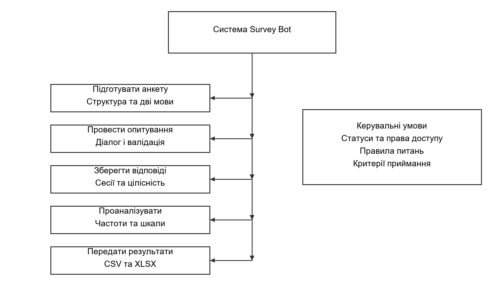

# РОЗДІЛ 1 ЗАГАЛЬНІ ПОЛОЖЕННЯ

## 1.1 Опис предметного середовища

### 1.1.1 Опитування як інформаційний процес

Предметне середовище охоплює організатора дослідження, адміністратора системи, респондента та споживача аналітичного звіту. В невеликому навчальному проєкті одна особа може поєднувати кілька ролей, однак у моделі їх доцільно розрізняти. Організатор визначає мету збирання даних, адміністратор готує анкету та забезпечує доступ, респондент надає відповіді, а аналітик формулює висновки в межах наявної вибірки. Помилка на будь-якому етапі не компенсується якісною діаграмою на останньому.

Одиницею спостереження в програмній системі є сесія проходження. Вона не тотожна користувачу: одна людина може взяти участь у кількох анкетах або повторно пройти ту саму анкету. Так само відповідь на питання не є завершеним проходженням. Для достовірної аналітики ці сутності мають різні ключі, часові позначки та правила підрахунку. Наприклад, п'ять відповідей на шкалу можуть належати п'яти різним сесіям, але меншій кількості унікальних респондентів.

Інформаційний цикл починається з формулювання управлінського питання. Якщо керівник курсу хоче оцінити навчальні матеріали, необхідно визначити, що саме означає оцінка: зрозумілість пояснень, актуальність тем чи зручність доступу. Загальне питання про «якість курсу» може об'єднувати кілька різних характеристик. Система автоматизує фіксацію відповідей, але не усуває помилки постановки дослідницької задачі.

Після визначення мети створюється анкета. Її зміст проходить перевірку формулювань, типів полів, порядку та мовних версій. Далі анкету публікують, респонденти виконують послідовність дій, а сервер накопичує відповіді. На завершальному етапі адміністратор отримує таблиці, частоти вибору та середні значення шкал. Вихідні дані можуть бути експортовані для додаткового аналізу. Замикання циклу відбувається лише тоді, коли за результатами прийнято рішення або уточнено наступну анкету.

### 1.1.2 Межі автоматизації

У межах Survey Bot автоматизовано керування структурою анкет, покрокове отримання відповідей, зберігання сесій та обчислення базових агрегатів. Добір респондентів, формулювання дослідницьких гіпотез і перевірка валідності шкал залишаються завданням організатора. Такий поділ запобігає перебільшенню можливостей програмного продукту: доступність каналу зв'язку не означає репрезентативності результатів.

Використання Telegram передбачає наявність облікового запису й доступу до мережі. Люди, які не користуються цим сервісом, не потрапляють до охоплення без альтернативного каналу. Якщо опитування проводиться серед учасників певного навчального чату, висновки стосуються саме залученої групи. Неможливо переносити її відповіді на всіх студентів університету без окремого обґрунтування вибірки.

У системі зберігаються Telegram ID, ім'я, прізвище та username, якщо вони надані платформою. Тому реалізована модель не є анонімною за своєю природою. Навіть якщо адміністратор не бачить справжнього імені людини, стабільний ідентифікатор дає змогу пов'язати сесії. Для анонімного дослідження потрібні інші правила мінімізації даних, зберігання відповідності й доступу. У поточній роботі не заявляється юридична відповідність певному режиму захисту персональних даних без окремої правової оцінки.

### 1.1.3 Типи питань та інформаційні властивості відповідей

Одинарний вибір задає взаємовиключні варіанти. Його базова статистика є розподілом кількості сесій за варіантами. Множинний вибір допускає кілька відповідей, тому сума частот може перевищувати кількість респондентів. Вільний текст зберігає формулювання учасника, але потребує якісного аналізу або окремої процедури кодування. Числова шкала забезпечує впорядкований набір допустимих значень; середнє є технічно доступним агрегатом, проте його зміст залежить від інтерпретації шкали.

Таблиця 1.1 - Властивості підтримуваних типів питань

| Тип | Значення у сховищі | Основна перевірка | Аналітичний результат |
|---|---|---|---|
| Один варіант | option_id | Варіант належить питанню | Частота кожного варіанта |
| Кілька варіантів | option_ids у JSONB | Усі ID належать питанню | Частота згадування варіанта |
| Вільний текст | text_value | Непорожній текст | Перелік первинних висловлювань |
| Шкала | number_value | Значення в межах шкали | Розподіл і середнє |

Обов'язковість питання є окремою властивістю, а не п'ятим типом. Якщо питання необов'язкове, відсутність відповіді не має трактуватися як нульова оцінка. Нуль у шкалі також є повноцінним значенням за умови, що він дозволений межами. Саме тому застосування логічного виразу «значення або один» є помилковим для мінімуму шкали: воно підміняє дозволений нуль значенням за замовчуванням.

У двомовній анкеті український і англійський тексти описують одну інформаційну сутність. Переклад не повинен створювати нове питання або новий варіант із іншим ключем. Якщо відмінність мови змінює ідентичність сутності, відповіді стають непорівнюваними. Отже, локалізація є властивістю представлення, тоді як питання та варіант мають стабільні внутрішні ID.

### 1.1.4 Зацікавлені сторони та критерії цінності

Адміністратор оцінює продукт за часом підготовки анкети, зрозумілістю стану збереження та можливістю знайти потрібні результати. Респондент очікує передбачуваної послідовності, зрозумілих кнопок і можливості скасувати проходження. Аналітик потребує однозначного тлумачення показників. Розробнику важливі відтворюване середовище, контроль змін і діагностика помилок. Для керівника навчального проєкту результатом є не лише інтерфейс, а підтверджений зв'язок між завданнями, реалізацією та перевірками.

Таблиця 1.2 - Зацікавлені сторони проєкту

| Сторона | Очікуваний результат | Основний ризик |
|---|---|---|
| Респондент | Пройти одну анкету без втрати прогресу | Перехід до іншого сценарію або збій мережі |
| Адміністратор | Підготувати й опублікувати коректну анкету | Непомітне незбереження змін |
| Аналітик | Отримати відтворювані підрахунки | Втрата зв'язків або неправильний знаменник |
| Розробник | Відтворити запуск і помилку | Нефіксовані версії залежностей |
| Керівник проєкту | Прийняти перевірений результат | Формальне завершення без тестів |

### 1.1.5 Якість анкети та загрози валідності

Технічна валідність відповіді означає, що її значення допустиме за схемою. Методологічна валідність означає, що відповідь справді характеризує досліджуване явище. Ці поняття не тотожні. Значення «5» може пройти перевірку шкали від одного до п'яти, але залишатися неінтерпретованим, якщо респондент не розуміє, який край шкали означає позитивну оцінку. Тому біля числового поля необхідна змістова інструкція в тексті питання.

Слід уникати подвійних формулювань. Питання «Чи зручна та швидка система?» об'єднує дві характеристики, які можуть мати протилежні оцінки. Для Survey Bot доцільніше створити два шкальні питання: про зручність проходження і про сприйняту швидкість. Водночас сприйнята швидкість не замінює технічного вимірювання затримки HTTP. Перша є суб'єктивною оцінкою, друга - характеристикою виконання конкретного запиту.

Порядок питань може впливати на контекст відповіді. Якщо спочатку запропонувати перелік недоліків, наступна загальна оцінка може акцентувати саме проблеми. У межах цього проєкту не проводився експеримент рандомізації порядку, тому величина такого впливу не оцінювалася. Проте можливість змінювати порядок у редакторі важлива для пілотного узгодження анкети. Після початку основного збирання даних цей порядок доцільно фіксувати як частину версії.

Відсутність відповіді теж є інформацією. Вона може означати небажання повідомляти дані, незрозумілість формулювання, технічний збій або переривання діалогу. Без журналу подій неможливо однозначно визначити причину кожного пропуску. Саме тому кількість незавершених сесій не повинна автоматично трактуватися як кількість незадоволених учасників. Скасування також не є негативною оцінкою сервісу.

Мовна еквівалентність потребує перевірки не лише буквального перекладу, а й значення варіантів. Наприклад, «рідко» не задає конкретної частоти, а «кілька разів на тиждень» задає іншу категорію. Якщо англійська версія використовує іншу часову рамку, спільна діаграма об'єднує несумірні відповіді. Автоматичний переклад зменшує обсяг ручного введення, але відповідальність за еквівалентність залишається в адміністратора анкети.

Рекомендований пілотний перегляд має включати перевірку двох мов іншою особою, проходження анкети в Telegram, звірку збережених значень та відкриття експорту. Це рекомендація процесу, а не заявлена апробація. Університетська або організаційна пілотна вибірка в цьому дослідженні не створювалася. Наявні демонстраційні відповіді не дають підстав розраховувати надійність шкали чи статистичну значущість відмінностей між групами.

Таблиця 1.3 - Загрози достовірності та межі автоматизації

| Загроза | Приклад у системі | Що може перевірити ПЗ | Що потребує дослідника |
|---|---|---|---|
| Неповне охоплення | Немає Telegram у частини аудиторії | Факт отриманих сесій | Відповідність охоплення цільовій сукупності |
| Подвійне питання | Зручність і швидкість одним балом | Допустимий числовий діапазон | Однозначність вимірюваної ознаки |
| Нерівний переклад | Різні часові рамки UA/EN | Наявність обох полів | Змістова еквівалентність |
| Повторна участь | Кілька сесій одного ID | Зв'язок із респондентом | Політика допуску повторів |
| Пропущена відповідь | Перерваний діалог | Статус і наявність запису | Причина пропуску |
| Невдала інтерпретація | Середнє подано як доказ якості | Арифметичний розрахунок | Обґрунтованість висновку |

## 1.2 Аналіз аналогів та успішних сценаріїв

### 1.2.1 Критерії порівняння

Порівняння проведено за відповідністю заданому сценарію, а не за загальним рейтингом сервісів. Обрано канал участі, конструктор питань, зберігання й експорт, можливість модифікації серверної логіки та керованість локального розгортання. Комерційні тарифи, обмеження кількості відповідей та обіцянки конверсії не використано як сталі характеристики, оскільки вони змінюються й потребують окремої перевірки на дату придбання.

Google Forms забезпечує створення форм і тестів, збирання відповідей та перегляд результатів, включно з графіками й передаванням даних у Google Sheets [@forms]. Для навчального або організаційного опитування його сильна сторона полягає в готовому браузерному процесі. Відмінність від Survey Bot у цій роботі стосується каналу респондента та контролю над прикладним сервером, а не твердження про відсутність у Google Forms аналітики.

SurveyMonkey документує широкий набір типів питань та елементів анкети [@monkey]. Його доцільно розглядати, коли пріоритетом є використання готової дослідницької платформи. У студентському проєкті така платформа не замінює власного проєктування REST API, БД і FSM. Саме потреба продемонструвати ці компетентності обґрунтовує розробку власного обмеженого продукту, а не його перевагу над зрілим сервісом загалом.

Typeform пропонує різні типи запитань та інструменти побудови форм [@typeform]. Порівняння з ним корисне для оцінювання послідовного подання питань. Однак покроковість сама по собі не доводить кращої завершуваності. Для такого висновку потрібне контрольоване порівняння однакових анкет, аудиторій і умов. У Survey Bot послідовність обрана насамперед як природний формат діалогу в месенджері.

Tally використовує блокову модель побудови форм і документує текстові поля, множинний вибір та рейтингові елементи [@tally]. Цей підхід демонструє важливість низького порога підготовки анкети. Для власної адмін-панелі з нього випливає проєктний критерій: типовий сценарій не повинен вимагати зайвих переходів, а додавання питання має бути доступне біля місця поточної роботи.

Стандартні Telegram-опитування підтримують, зокрема, множинні відповіді та режим вікторини [@polls]. Вони придатні для швидкого голосування в межах платформи. Проте вбудоване голосування та описана в роботі серверна система мають різні межі відповідальності: Survey Bot керує власними анкетами, сесіями, текстовими відповідями й зовнішньою вебаналітикою. Це не означає, що кожному організатору потрібен власний сервер.

Таблиця 1.4 - Порівняння рішень у контексті навчального проєкту

| Рішення | Основний канал | Сильна сторона для задачі | Компроміс |
|---|---|---|---|
| Google Forms | Вебформа | Готовий конструктор і звіти | Власна серверна логіка не є предметом продукту |
| SurveyMonkey | Вебанкета | Різноманітні питання | Складність функцій перевищує навчальний обсяг |
| Typeform | Вебформа | Виразне подання анкети | Інший канал взаємодії з респондентом |
| Tally | Вебформа | Блокове редагування | Не реалізує заданий Telegram FSM як власний код |
| Telegram Polls | Месенджер | Швидке голосування | Не тотожне власній реляційній моделі анкет |
| Survey Bot | Telegram і вебадмінка | Контроль коду, схеми та локального запуску | Потрібні супровід і контроль безпеки |

### 1.2.2 Сценарій навчального зворотного зв'язку

Для навчального курсу доцільна коротка анкета з оцінкою матеріалів, вибором формату навчання, переліком корисних тем і текстовою пропозицією. Вона використовує всі чотири реалізовані типи питань без надмірної довжини. Результат дає змогу перевірити, чи збігається загальне враження з конкретними побажаннями, але не вимірює автоматично рівень знань або якість викладання.

До публікації організатор має перевірити, чи однаково описані крайні значення шкали в обох мовах. Якщо український текст запитує про зручність, а англійський про задоволеність, об'єднання результатів буде методологічно сумнівним навіть за бездоганних зовнішніх ключів. Автоматичний переклад розглядається як допоміжна чернетка, після якої адміністратор перевіряє зміст.

Технічний критерій успіху цього сценарію: завершена сесія містить допустимі відповіді, множинний вибір показано текстами, а зміна мови адміністратора не змінює числових результатів. Дослідницький критерій інший: отримані відповіді придатні для конкретного управлінського рішення. Ці два критерії не слід підміняти один одним.

### 1.2.3 Сценарій оцінювання сервісу

Для сервісного підрозділу питання можуть стосуватися загальної оцінки, каналу звернення, напрямів покращення та короткого коментаря. Одинарний вибір каналу потребує взаємовиключних варіантів або чіткої інструкції щодо останнього звернення. Інакше людина, яка користувалася і сайтом, і телефоном, не знатиме, який варіант обрати. Таке обмеження не є помилкою бота; це наслідок дизайну анкети.

Множинний вибір напрямів покращення має інший знаменник, ніж частка завершених сесій. Якщо двоє учасників позначили по три напрями, система отримає шість виборів, але лише дві відповіді на питання. Діаграма повинна відображати частоти згадування, а не помилково трактувати шість виборів як шість респондентів.

Текстові коментарі зберігаються без автоматичного перекладу. Це забезпечує первинність матеріалу й дозволяє відрізнити висловлювання респондента від редакторської інтерпретації. Якщо аналітику потрібен переклад коментаря, він має бути окремим похідним полем, а не заміною оригіналу. Поточна реалізація такої похідної обробки не виконує.

### 1.2.4 Вибір рішення залежно від обмежень проєкту

Вибір між готовим сервісом і власним продуктом є управлінським рішенням щодо витрат та відповідальності. Готова платформа переносить значну частину супроводу на постачальника. Власна система дає контроль над схемою, сценарієм та розгортанням, але разом із ним передає команді обов'язок оновлювати залежності, захищати секрети й відновлювати дані. Контроль без відповідного процесу може збільшити ризики, а не зменшити їх.

Якщо мета організатора - провести одноразове коротке опитування без особливих інтеграцій, власна розробка зазвичай потребує додаткового обґрунтування. Якщо ж мета навчального проєкту включає проєктування БД, REST-контрактів, FSM і процедур приймання, використання лише готової вебформи не забезпечує потрібних результатів розробки. Таким чином, критерій доцільності залежить від мети проєкту, а не від абстрактної кількості функцій.

Для Survey Bot пріоритетними є можливість локального запуску, контроль первинних відповідей і узгодженість двох клієнтських контурів. Розширений дизайн форм, оплата через анкету чи складні маркетингові інтеграції не входять до обов'язкового обсягу. Така пріоритизація дозволяє не конкурувати із зрілими платформами за всіма параметрами одночасно та зосередити тестування на ризиках конкретного сценарію.

Таблиця 1.5 - Критерії рішення про власну розробку

| Умова проєкту | Аргумент за готову платформу | Аргумент за власну систему |
|---|---|---|
| Потрібна лише одна анкета | Мінімальний обсяг налаштувань | Перевага не доведена |
| Потрібен власний Telegram-діалог | Можливості інтеграції треба перевіряти окремо | Керований FSM є частиною реалізації |
| Потрібна демонстрація повного стеку | Не покриває власну серверну розробку | Безпосередньо відповідає навчальній меті |
| Немає ресурсу супроводу | Значна частина операцій у постачальника | Потрібен відповідальний за експлуатацію |
| Потрібна зміна схеми даних | Залежність від моделі постачальника | Міграції під контролем команди |
| Є вимоги до локального показу | Потрібна перевірка доступності мережі | Контейнери можна підготувати заздалегідь |

Підтримка локального показу не означає повної автономності. Адмін-панель, API та БД можуть працювати на одному комп'ютері, але реальний Telegram і зовнішній перекладач потребують мережі. Для захисту слід розділити демонстраційні сценарії: локальний конструктор та аналітика демонструються незалежно, а проходження в Telegram перевіряється за наявності доступу до сервісу. Невдача одного зовнішнього компонента не повинна приховувати працездатність решти.

Важливо також не підміняти порівняння функціональності порівнянням безпеки. Наявність відкритого коду дозволяє провести аудит, але не доводить, що аудит уже повний. Так само наявність JWT не робить продукт автоматично безпечнішим за готовий сервіс. У цій роботі сформульовано конкретні перевірки доступу та залишкові ризики замість необґрунтованої загальної оцінки.

### 1.2.5 Емпіричні дослідження діалогового опитування

Дослідження Beam порівнює вебформи й чатботи в рандомізованому експерименті серед учителів на Філіппінах, залучених через соціальні медіа, та зіставляє їх із телефонним опитуванням [@beam]. Робота важлива як приклад того, що канал і спосіб залучення необхідно перевіряти емпірично. Її результати не є вимірюванням Survey Bot, української студентської аудиторії або Telegram-сценарію цього проєкту.

Для власного порівняльного досліду необхідно підготувати однакову анкету у вебформі й боті, випадково розподілити учасників та заздалегідь визначити показники: завершення, тривалість, пропуски й змістовність тексту. Слід також відокремити технічні збої від добровільного переривання. У поточному дослідженні такий експеримент не проводився; наведено його дизайн як наступний етап оцінювання. Технічна готовність артефакту створює передумову для досліду, але не замінює його.

## 1.3 Постановка задачі

### 1.3.1 Функціональна модель

Функціонально система поділяється на підготовку анкети, проведення опитування, зберігання подій і відповідей, аналіз та експорт. Кожна функція має вхід, результат і контрольні умови. Наприклад, проведення опитування отримує активну анкету та дані респондента, формує сесію й відповіді, а контролюється статусом анкети, типами питань та правилами допустимості.

На контекстному рівні входами є визначення анкети, мовні тексти, команди й відповіді респондента, а виходами є збережена сесія, підтвердження завершення, таблиця відповідей та агрегований звіт. Механізмами виступають Telegram API, веббраузер, FastAPI та PostgreSQL. Контроль охоплює права доступу, схему даних і правила приймання. Така модель дає змогу перевірити повноту вимог до початку деталізації класів.

### 1.3.2 Функціональні вимоги

Таблиця 1.6 - Основні функціональні вимоги

| Код | Вимога | Критерій приймання |
|---|---|---|
| FR01 | Авторизація адміністратора | Неправильні дані дають 401; правильні повертають JWT |
| FR02 | CRUD анкет | Створена й відредагована анкета читається повторно |
| FR03 | Статуси draft, active, closed | Бот отримує лише активні анкети |
| FR04 | Керування питаннями | Порядок і тип відтворюються після читання |
| FR05 | Чотири типи відповідей | Сервер приймає допустимі та відхиляє недопустимі значення |
| FR06 | Покрокове проходження | Наступне питання доступне після успішного запису |
| FR07 | Завершення сесії | Обов'язкові питання мають відповіді |
| FR08 | Аналітика | Частоти збігаються з контрольними відповідями |
| FR09 | CSV та XLSX | Експорт читається стандартним парсером |
| FR10 | Дві мови | Тексти обох мов зберігаються незалежно |
| FR11 | Переклад анкети | Незаповнена мовна пара доповнюється або показано помилку сервісу |
| FR12 | Інструкція і скасування | /help не нав'язується; /cancel завершує активний сценарій |

Критерії сформульовано так, щоб їх можна було спростувати тестом. Вимога «сучасна панель» сама по собі не перевіряється, тоді як «після збереження й оновлення сторінки англійський текст не зникає» має однозначний очікуваний результат. У процесі управління це зменшує ризик формального приймання функції за наявністю кнопки.

### 1.3.3 Нефункціональні вимоги й обмеження

Відтворюваність означає наявність конфігурації сервісів, послідовності міграцій і зафіксованих залежностей. Цілісність означає стабільність ключів та перевірку допустимих відповідей. Зручність означає помітний результат збереження, доступність додавання питання внизу форми й відсутність необхідності створювати дві окремі анкети для двох мов. Безпека означає розмежування адміністративного та службового доступу, приховування секретів і обмеження мережевого оприлюднення.

Таблиця 1.7 - Нефункціональні вимоги

| Код | Вимога | Спосіб перевірки |
|---|---|---|
| NFR01 | Відтворюване середовище | Docker build і міграція порожньої тестової БД |
| NFR02 | Стабільні варіанти | Регресійний тест збереження option_id |
| NFR03 | Захищені адміністративні дані | Запит без JWT не повертає таблиці відповідей |
| NFR04 | Службова автентифікація бота | Запит без X-Bot-Key відхиляється |
| NFR05 | Адаптивне представлення | Перевірка вузького та широкого viewport |
| NFR06 | Контроль експорту | Формули не виконуються як комірки XLSX |
| NFR07 | Діагностованість | Логи запуску й окремі протоколи тестів |

У першу версію не включено довільне розгалуження анкети, бальне оцінювання правильності, машинне навчання, автоматичну тематичну класифікацію текстів, багаторівневі ролі та промислове масштабування. Вони потребують інших вимог і не повинні виникати в описі як уже реалізовані можливості. Термін «тест» у побутовому інтерфейсі тут означає анкету, а не систему перевірки знань із правильними відповідями.

### 1.3.4 Доказова модель приймання

Для кожної вимоги визначено артефакт реалізації та тип доказу. Наявність Pydantic-схеми доводить опис поля, але не його правильне проходження через браузер. Тест сервісної функції з PostgreSQL доводить поведінку цієї функції, але не роботу Telegram-клавіатури. HTTP-тест перевіряє маршрути й серіалізацію. Лише реальне проходження через Telegram-клієнт охоплює доставлення повідомлень і роботу платформи.

Такий поділ є частиною управління якістю, оскільки забороняє підміняти завершення робіт показом окремого компонента. Водночас він дозволяє продовжувати незалежні перевірки, якщо певний зовнішній сервіс недоступний. Наприклад, відмова перекладача не блокує перевірку збереження введених вручну мовних версій.

### 1.3.5 Приймальні сценарії та дослідницькі питання

Перший приймальний сценарій описує підготовку україномовної анкети без англійського тексту. Адміністратор вводить назву, опис і питання в українській колонці, зберігає та оновлює сторінку. Очікуваний результат: українські значення відтворюються без перенесення в EN, англійські поля залишаються порожніми. Цей сценарій перевіряє семантику зберігання, а не лише видимий порядок колонок.

Другий сценарій доповнює переклад. Якщо зовнішній сервіс доступний, одна команда обробляє всі незаповнені мовні пари. Якщо він недоступний, інтерфейс показує помилку й не повідомляє про успіх. Після ручного або автоматичного заповнення другої мови та збереження обидва тексти мають відтворюватися після reload. Якість перекладу перевіряється окремо від збереження.

Третій сценарій перевіряє історичну відповідність. Спочатку респондент обирає варіант. Потім адміністратор змінює лише текст перекладу цього варіанта. Очікуваний результат: ID не змінюється, відповідь посилається на той самий запис, а частота залишається незмінною. Якщо графік порожній, система не повинна виправляти це випадковим призначенням нових відповідей.

Четвертий сценарій стосується завершення. Створена порожня сесія не може перейти в completed, якщо анкета має обов'язкові питання. Після допустимих відповідей завершення успішне, а повторний запит не змінює його результат. Цей сценарій перевіряє серверний інваріант незалежно від того, чи надходить запит від бота або тестового HTTP-клієнта.

П'ятий сценарій перевіряє представлення результатів: переключення UA/EN змінює назви анкети, питання й варіанта, але не змінює значення частоти чи середнього. Вільний текст залишається оригінальним. Відсутній переклад позначає неповноту мовного наповнення, а не дає право перекладати первинний коментар без збереження його початкової форми.

Шостий сценарій перевіряє доступ. Клієнт без адміністративного JWT не отримує список відповідей, а клієнт без службового ключа не створює Telegram-сесію. Відмова має бути контрольованою HTTP-відповіддю, а не падінням процесу. Для публічного розгортання цей мінімум потрібно доповнити HTTPS, обмеженням частоти й перевіркою прав на конкретну сесію.

Дослідницьке питання RQ1: чи можна пов'язати вимогу двомовного редагування з перевірюваним інваріантом історичних відповідей? RQ2: які дефекти виникають на межі DTO, ORM і React state? RQ3: які докази достатні для заяви про робочий локальний сценарій, а які потребують окремого E2E? Відповіді на ці питання отримуються інспекцією й тестами артефакту, а не вигаданою статистикою користувачів.

## Висновки до розділу 1

Предметну область визначено як керований цикл підготовки анкети, збирання відповідей і формування даних для рішень. Встановлено відмінність між користувачем, сесією та відповіддю, а також між програмною коректністю й дослідницькою валідністю. Порівняння аналогів обґрунтовує власну розробку заданим каналом участі, контролем коду та навчальними цілями, але не доводить загальної переваги над комерційними платформами.

Сформовано функціональні й нефункціональні вимоги, визначено межі першої версії та перевірювані критерії приймання. Особливу увагу приділено стабільності ідентифікаторів під час перекладу, обов'язковості питань і достовірності аналітичних підрахунків. Ці вимоги є основою інформаційного проєктування й плану розробки в наступному розділі.
