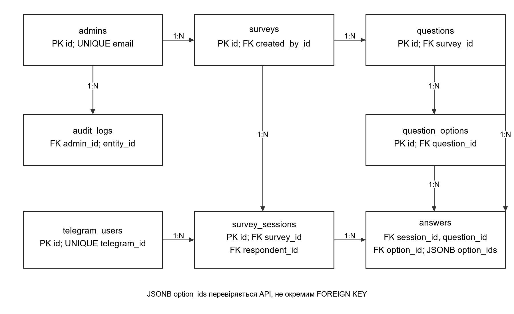
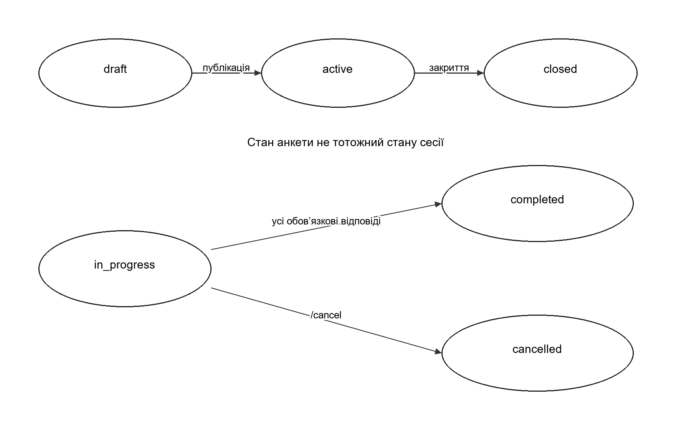
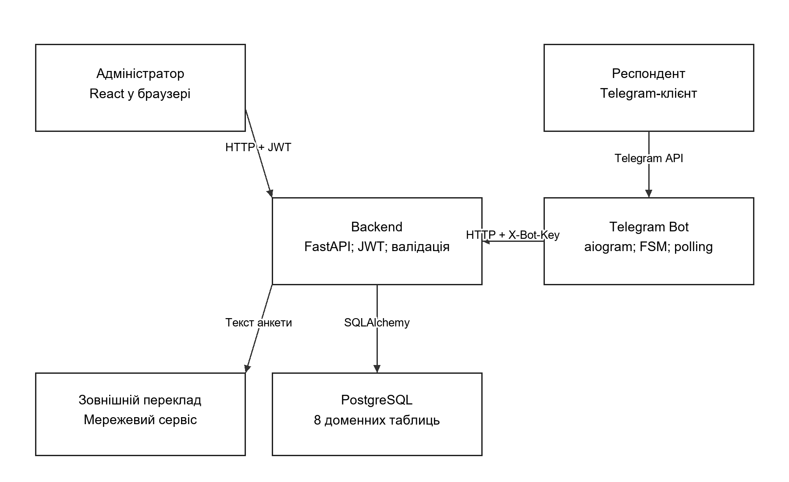
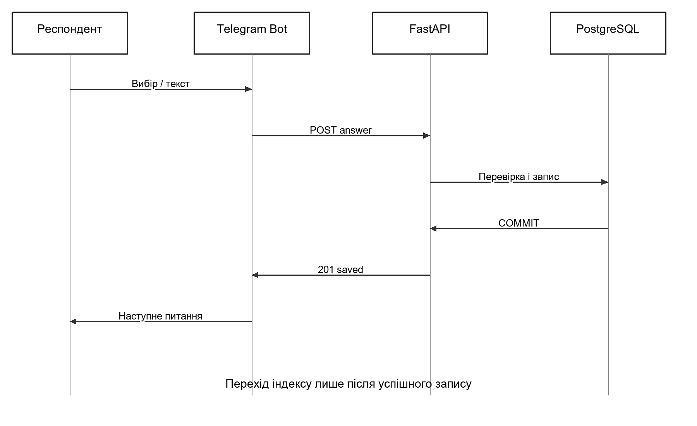

# РОЗДІЛ 2 ІНФОРМАЦІЙНЕ ТА МЕТОДОЛОГІЧНЕ ЗАБЕЗПЕЧЕННЯ

## 2.1 Аналіз предметної області вхідних і вихідних даних

### 2.1.1 Інформаційні потоки та власники даних

Система має два незалежні клієнтські контури. Адміністратор працює через браузер і передає серверу структуру анкети, мовні тексти та запити до звітів. Респондент взаємодіє з Telegram-ботом, який перетворює повідомлення й натискання кнопок на запити до REST API. База даних доступна серверній частині; бот не відкриває пряме SQL-з'єднання, а фронтенд не отримує реквізитів PostgreSQL. Це забезпечує одну точку перевірки бізнес-правил.

Telegram Bot API визначає транспорт повідомлень, callback query та клавіатур [@telegram]. У межах досліджуваного рішення polling обрано через простоту локальної демонстрації: не потрібен публічний HTTPS endpoint для вхідного webhook. Цей вибір не усуває залежності від Інтернету. Крім того, один токен не можна безконтрольно використовувати для кількох одночасних polling-процесів, оскільки це створює конфлікт отримання оновлень.

У контурі підготовки анкети сервер є власником збереженого стану, а React-форма містить його тимчасову редаговану копію. До натискання «Зберегти» переклад або зміна варіанта не є зміною бази. Саме тому в інтерфейсі потрібні окремі стани «виконується», «успішно» та «помилка». Стан кнопки чи текст у полі не можуть виступати доказом фіксації даних.

У контурі проходження сервер володіє відповідями й статусом сесії, тоді як FSM бота зберігає позицію діалогу та поточний набір вибраних варіантів. Ці стани можуть розійтися, наприклад, після перезапуску процесу. Тому довгострокова архітектура має передбачати відновлення діалогу за серверною сесією або персистентне FSM-сховище. Поточна MemoryStorage не повинна описуватися як стійка до перезапуску.

Таблиця 2.1 - Вхідні та вихідні набори даних

| Потік | Вхідні дані | Вихідні дані | Контроль |
|---|---|---|---|
| Авторизація | Email і пароль | JWT адміністратора | Хеш пароля, активність облікового запису |
| Підготовка анкети | Назва, опис, статус | Survey з ID | Довжина, допустимий статус |
| Питання | Тексти, тип, позиція, варіанти | Question та Option | Мовні поля, межі шкали |
| Початок | ID анкети та респондента | SurveySession | Активність анкети |
| Відповідь | ID питання і значення | Answer | Належність питання й допустимість значення |
| Аналітика | Фільтри анкети й дат | Агрегати та розподіли | Узгоджені умови відбору |
| Експорт | ID анкети і формат | CSV або XLSX | Адміністративний доступ, безпечні комірки |

### 2.1.2 Концептуальна модель даних

Основні сутності моделі: адміністратор, респондент, анкета, питання, варіант, сесія, відповідь і запис аудиту. Зв'язок анкети з питаннями має кратність один до багатьох, як і зв'язок питання з варіантами. Сесія належить конкретній анкеті та респонденту. Відповідь належить сесії й питанню. Адміністратор може створити кілька анкет, а журнал аудиту пов'язує його дії з об'єктами системи.

UML використано для опису ролей та поведінки, а ER-представлення для структури зберігання; це різні рівні моделі, хоча вони посилаються на спільні сутності [@uml]. У діаграмі варіантів використання важлива мета актора, а в ER-діаграмі - ключі та кратності. Заміна одного виду іншим без пояснення призводить до втрати частини вимог.

Логічно відповідь на одинарний вибір має один зовнішній ключ option_id. Множинний вибір у наявній реалізації зберігає список ID у JSONB. Такий компроміс спрощує обмін із ботом, але PostgreSQL не забезпечує зовнішній ключ для кожного елемента масиву автоматично. Належність усіх елементів перевіряє прикладний код. Для суворішої реляційної моделі доцільна окрема таблиця answer_options із двома зовнішніми ключами.

Обмеження NOT NULL, UNIQUE і FOREIGN KEY забезпечують різні види цілісності, а не дублюють одна одну [@pg]. Унікальний Telegram ID запобігає створенню двох записів одного респондента, але не забороняє дві сесії. Зовнішній ключ відповіді на питання не гарантує, що це питання належить анкеті сесії: таку складену умову необхідно додатково перевіряти.

### 2.1.3 Життєвий цикл та інваріанти

Анкета проходить стани draft, active та closed. Чернетка використовується для підготовки, активна анкета доступна в боті, закрита не пропонується для нового проходження. Наявність статусу не означає реалізацію незмінних версій. У поточній системі адміністратор може змінювати структуру вже опублікованої анкети, тому перед суттєвим редагуванням необхідна управлінська політика закриття й створення нової версії.

Сесія починається зі стану in_progress. Завершення допустиме, коли всі обов'язкові питання мають збережені відповіді. Скасування переводить її в cancelled і не видаляє вже надані відповіді. Скасована сесія не може бути завершена, а завершена не приймає нові відповіді. Повторний запит завершення вже завершеної сесії повертає її стан без зміни часової позначки. Це спрощує відновлення після мережевої невизначеності.

Інваріант I1: відповідь належить питанню тієї самої анкети, що й сесія. I2: ідентифікатор варіанта зберігається під час редагування лише його тексту. I3: значення шкали не виходить за встановлені межі, включно з нулем, якщо він дозволений. I4: статус completed не встановлюється за наявності пропущених обов'язкових питань. I5: мовна версія не змінює ідентичності питання чи значення підрахованих частот.

Вимога однієї відповіді на пару session_id та question_id у поточній реалізації підтримується послідовністю видалення попереднього й додавання нового запису. За послідовних запитів це працює як заміна відповіді, що підтверджено тестом. За конкурентних запитів потрібне окреме унікальне обмеження або UPSERT, тому повну конкурентну гарантію на цій підставі не заявлено. Це приклад різниці між бажаним інваріантом і фактичним механізмом його забезпечення.

### 2.1.4 Мовна модель

У таблицях збережено базовий текст та окремі поля української й англійської мов. Базове поле підтримує сумісність із попередньою схемою, а явні поля задають мовні представлення. Для анкети це title_uk, title_en, description_uk і description_en; для питання й варіанта - text_uk та text_en. Порожня англійська колонка означає відсутній переклад, а не дозвіл записати туди український текст.

Перехід від старої схеми до симетричної локалізації містить ризик помилкової атрибуції мови. Раніше поле text могло містити будь-яку мову, а міграція механічно заповнювала text_en з text. Визначення кирилиці є лише евристикою очищення старих даних, а не повноцінним визначенням української мови. Воно не відрізняє українську від інших кириличних мов і не допомагає для коротких нейтральних назв на кшталт API.

Для нових анкет адміністратор явно заповнює потрібну колонку. Кнопка перекладу доповнює відсутню сторону мовної пари та не повинна перезаписувати вже відредаговану другу версію без окремого наміру користувача. Відсутність обох текстів не усувається перекладачем. Статус успішного перекладу також не означає збереження анкети.

При відображенні аналітики мова інтерфейсу визначає заголовки питань і підписи варіантів. Первинні вільні відповіді залишаються мовою респондента. Якщо перекладу питання немає, використовується доступний базовий текст; це прозорий компроміс доступності, але не гарантія повністю одномовної сторінки. Для суворого мовного режиму слід вимагати повноту перекладу перед публікацією.

### 2.1.5 Правила формування аналітики

Для множини сесій S, відібраних за анкетою та часовим інтервалом, кількість проходжень дорівнює |S|. Кількість завершених визначається умовою status = completed. Унікальні респонденти підраховуються як кількість різних respondent_id саме у відібраних сесіях. Використання загальної кількості користувачів БД у звіті конкретної анкети створює семантичну помилку знаменника.

Частота одинарного варіанта j визначається кількістю відповідей із option_id = j. Для множинного вибору частота є кількістю відповідей, у яких j входить до option_ids. Якщо одна відповідь містить дубльовані ID, це не повинно збільшувати частоту, тому сервер усуває повтори перед збереженням. Для шкали середнє обчислюється лише за наявними числовими значеннями, а відсутній результат повертається як null, не як нуль.

Частка завершення C може бути обчислена як C = N_completed / N_started за ненульової кількості початих сесій. Проте її зміст залежить від політики повторних проходжень і скасування. Якщо одна людина створює кілька сесій, показник характеризує сесії, а не людей. У роботі не використано цей показник як доказ переваги Telegram над вебформами.

Часові фільтри в поточному API застосовуються до started_at сесії. Це означає, що сесія, розпочата до інтервалу й завершена всередині нього, не потрапляє до відбору. Така семантика має бути явно визначена у специфікації. Альтернативний звіт за датою відповіді або датою завершення є іншим запитом, а не виправленням того самого показника.

## 2.2 Проєктування системи та створення плану розробки

### 2.2.1 Архітектура та межі компонентів

Обрано модульний сервер із двома клієнтами. API маршрути згруповано за auth, surveys, respondents, responses, analytics, export, public і translate. Моделі SQLAlchemy описують структуру БД, Pydantic-схеми - контракти введення та виведення, а services містять частину операцій зі створення анкет, аудиту й аналітики. Не всі бізнес-правила винесено із маршрутів: збереження відповідей і завершення сесії наразі реалізовано безпосередньо у public endpoint.

Не варто називати це мікросервісною бізнес-архітектурою лише через наявність кількох контейнерів. Бот, фронтенд і БД є окремими процесами з різними ролями, але центральна доменна логіка розташована в одному backend. Для навчального проєкту це знижує складність транзакцій і локального розгортання. Поділ на окремі доменні сервіси був би виправданий лише за додаткових вимог масштабування або незалежного володіння модулями.

SQLAlchemy Session використовується як контекст роботи з ORM і транзакціями [@sa]. У поточній реалізації запити отримують сесію через залежність FastAPI, а commit виконується після успішної зміни. Важливо розрізняти flush, який синхронізує стан ORM із БД у межах транзакції, та commit, який фіксує її. Отримання ID після flush не є доказом довгострокового збереження після збою.

Alembic забезпечує послідовність змін схеми [@alembic]. Три наявні ревізії створюють базові таблиці, додають українські поля й симетричні англійські поля. Міграція тестової порожньої БД перевіряє працездатність шляху від початкового стану до head. Вона не є перевіркою безпечності downgrade на реальній БД, оскільки downgrade може видалити дані колонок.

### 2.2.2 Послідовність проходження

Після вибору анкети бот реєструє або оновлює респондента, створює серверну сесію та зберігає її ID у FSM. Для кожного питання формується клавіатура або очікування тексту. Відповідь передається на сервер; лише після успішного HTTP-результату індекс переходить до наступного питання. Наприкінці сервер перевіряє обов'язкові відповіді й фіксує завершення.

Ключова точка відмови розташована між серверним commit і отриманням відповіді ботом. Якщо запис відбувся, але HTTP-відповідь загубилася, клієнт не знає результату. Повторення запиту має бути безпечним, тому сервер замінює відповідь для тієї самої пари сесії та питання. Для повної стійкості за конкурентних повторів потрібне обмеження унікальності й ідемпотентна операція на рівні БД.

Службовий доступ бота відокремлено від JWT адміністратора. Клієнт передає X-Bot-Key, значення якого в поточній локальній версії отримується як SHA-256 від налаштованого токена бота. Це спільний секрет, а не доказ особи конкретного респондента. Володілець ключа може викликати службові операції, тому для мережевого розгортання потрібні TLS, керування секретами й окрема політика авторизації сесій.

### 2.2.3 Декомпозиція робіт

WBS побудовано за результатами, які можна перевірити. Декомпозиція «написати backend» недостатня, оскільки не показує залежностей між моделями, міграціями, контрактами й перевірками. Натомість пакет «зберігання відповіді» має результат у вигляді маршруту, серверної валідації та тесту чотирьох типів. Таку одиницю легше оцінювати та приймати.

Таблиця 2.2 - WBS проєкту Survey Bot

| Код | Пакет робіт | Результат |
|---|---|---|
| 1.1 | Аналіз акторів і сценаріїв | Межі системи й перелік вимог |
| 1.2 | Аналіз аналогів | Порівняльна матриця |
| 1.3 | Критерії приймання | Простежувана специфікація |
| 2.1 | ER і доменні інваріанти | Модель даних |
| 2.2 | REST-контракти | Схеми запитів та відповідей |
| 2.3 | Проєктування діалогу | FSM і клавіатури |
| 3.1 | БД та міграції | Схема PostgreSQL |
| 3.2 | Авторизація | Хешування і JWT |
| 3.3 | Конструктор анкет | CRUD і статуси |
| 3.4 | Сесії та відповіді | Серверні правила проходження |
| 3.5 | Аналітика й експорт | Перевірені агрегати та файли |
| 4.1 | Telegram-клієнт | Команди й покрокове проходження |
| 4.2 | React-панель | Сторінки адміністратора |
| 4.3 | Мультимовність | Мовні пари й переклад |
| 5.1 | Середовище | Docker Compose і конфігурація |
| 5.2 | Seed | Контрольний демонстраційний набір |
| 5.3 | Регресійні тести | Протоколи перевірок |
| 5.4 | Документація | README, інструкції та обмеження |
| 6.1 | Аудит результатів | Реєстр дефектів |
| 6.2 | Підготовка передачі | Гілка, PR і відтворюваний запуск |

Кожен пакет має критерій завершення. Наприклад, «аналітика» завершена не після появи стовпчика, а після звірки з контрольними значеннями для одинарного, множинного й числового типів. «Мультимовність» включає повторне відкриття збереженої анкети, оскільки помилка може міститися не в перекладачі, а в схемі PATCH-запиту. Це важлива залежність, виявлена під час фактичного аудиту.

### 2.2.4 Планування залежностей і ресурсів

Наведений план є нормативним планом наступної контрольованої ітерації, а не вигаданим історичним календарем виконаних робіт. Для одного основного виконавця пропонується шість тижневих інтервалів. Перший відведено вимогам і моделям, другий - БД та авторизації, третій - API і боту, четвертий - панелі, п'ятий - локалізації та аналітиці, шостий - регресії й передачі. Фактичні дати початкової розробки не відновлюються без журналу робіт.

Таблиця 2.3 - План контрольованої ітерації

| Інтервал | Основний результат | Залежність | Контрольна точка |
|---|---|---|---|
| Тиждень 1 | Вимоги та моделі | Узгоджена тема | Погоджені критерії |
| Тиждень 2 | Міграції та auth | Модель даних | Порожня БД мігрується |
| Тиждень 3 | API проходження і бот | Стабільні контракти | Чотири типи записуються |
| Тиждень 4 | Редактор і сторінки | CRUD API | Зміни переживають reload |
| Тиждень 5 | Мови, графіки, експорт | Відповіді й редактор | Звірка контрольної статистики |
| Тиждень 6 | Регресія та передача | Інтегрований продукт | Протокол приймання |

Критичний ланцюг залежностей проходить через модель даних, міграції, API відповідей, клієнтський сценарій і перевірку результатів. Роботу над зовнішнім оформленням панелі можна виконувати до завершення аналітики, але приймання графіків залежить від стабільного формату відповіді API. Переклад текстів документації можна вести паралельно, проте опис фактичної реалізації має спиратися на зафіксовану версію коду.

Оцінка ресурсів не повинна видавати умовну ставку за фактичні витрати. Для навчального планування достатньо обліковувати людино-години за пакетами, а за потреби застосувати формулу B = Σ(h_i × r_i) + C_infra + R. Тут h_i є оцінкою трудомісткості, r_i - погодженою ставкою, C_infra - реальними інфраструктурними платежами, R - резервом. У цій роботі комерційну вартість не обчислено, оскільки ставок і підтверджених трудовитрат немає.

### 2.2.5 Керування змінами

Зміна вимоги повинна містити причину, вплив і спосіб перевірки. Наприклад, запит «зробити одну кнопку перекладу» впливає на клієнтський алгоритм обходу мовних пар, але не потребує дублювання анкети. Запит «показувати мову інтерфейсу в аналітиці» впливає на DTO питань і варіантів, а не на первинні відповіді. Такий аналіз допомагає обмежити зміни відповідними модулями.

Найризикованіші зміни стосуються ідентичності й історії. Перестановка варіанта не повинна створювати новий ключ; видалення вибраного варіанта може зруйнувати інтерпретацію старих відповідей; зміна типу питання змінює допустиму структуру значення. Тому для опублікованих анкет доцільно дозволяти лише виправлення текстів, а структурні зміни оформлювати новою версією.

Виправлення виконуються в окремій гілці codex/thesis-audit. Pull Request є точкою перегляду, а не автоматичним підтвердженням якості. Він повинен містити стислий опис поведінкових змін, перелік перевірок і відомі обмеження. Основну гілку не змінюють до погодження. Особисті дані респондентів, дампи БД і .env не включають до публічного PR.

## 2.3 Методології управління розробкою

### 2.3.1 Застосовність Agile Scrum та Kanban

Agile-маніфест наголошує на цінності працюючого програмного забезпечення, співпраці та готовності до змін [@agile]. Для Survey Bot це означає перевірку коротких наскрізних сценаріїв і уточнення вимог за реальним використанням. Водночас Agile не скасовує документацію: без визначення статусів, знаменників і правил локалізації зміни призводять до неузгодженої поведінки.

Scrum визначає ролі, події та артефакти командного процесу [@scrum]. У проєкті з одним основним виконавцем не слід заявляти повне впровадження Scrum лише через поділ робіт на тижні. Можна використати backlog, ціль ітерації та огляд результату, але окремі ролі Product Owner і Scrum Master потребують реального розподілу відповідальності. У роботі Scrum розглядається як застосовний орієнтир, а не як підтверджена історія проведених церемоній.

Kanban зосереджується на визначенні й візуалізації потоку, управлінні роботою та його вдосконаленні [@kanban]. Для аудиту невеликого продукту доречні колонки «підтверджено», «в роботі», «на перевірці», «прийнято» і явний ліміт незавершених змін. Це дає змогу не накопичувати одночасно багато неперевірених виправлень. Після зміни контракту слід завершити регресію, перш ніж переходити до наступного незалежного дефекту.

Обрано адаптивний процес із попереднім моделюванням критичних інваріантів і короткими реалізаційними ітераціями. Фіксованими залишаються мета, обов'язкові результати та критерії якості; послідовність менш ризикованих задач може змінюватися. Такий підхід відповідає природі навчального продукту, де уточнення інтерфейсу виникають після демонстрації, а дані вже можуть бути накопичені.

### 2.3.2 Управління ризиками

Ризик оцінюється за ймовірністю та наслідком на якісній шкалі 1-3. Добуток цих оцінок використовується лише для впорядкування, а не як статистично доведена очікувана втрата. Власник ризику відповідає за запобіжну дію та сигнал перегляду. Наприклад, ризик втрати відповідності варіантів належить серверній частині, але його прояв може бути помітним лише на графіку фронтенду.

Таблиця 2.4 - Реєстр ризиків

| Ризик | Ймовірність / вплив | Запобіжна дія | Сигнал перегляду |
|---|---|---|---|
| Втрата ID варіанта | 3 / 3 | Зберігати ID у PATCH і тестувати зв'язки | Порожня діаграма за наявних відповідей |
| Вигадане відновлення даних | 2 / 3 | Лише read-only аудит та перевірений backup | Автоматична підстановка без джерела |
| Збій перекладача | 3 / 2 | Ручне введення, явна помилка 503 | Недоступність зовнішнього сервісу |
| Втрата FSM після restart | 3 / 2 | План персистентного сховища | Бот не пам'ятає активну сесію |
| Одночасні натискання | 2 / 2 | Ізоляція подій і серверна перевірка | Повторний запис або зміщення індексу |
| Розголошення токена | 2 / 3 | .env у gitignore, секрети поза логами | Секрет у diff або URL звіту |
| Нестабільна збірка | 3 / 2 | Фіксовані версії та lockfile | Новий build ламається без зміни коду |
| Підміна службового запиту | 2 / 3 | Ключ бота й мережеве обмеження | Доступ без службових реквізитів |
| Формула в експорті | 2 / 3 | Екранування небезпечних комірок | Значення починається з формульного символу |
| Неправильний знаменник | 2 / 2 | DISTINCT respondent_id у фільтрі | Кількість не змінюється між анкетами |
| Неповний доказ E2E | 3 / 2 | Розділення типів тестів | Mock названо реальним Telegram-тестом |
| Недоступні офіційні матеріали | 3 / 2 | Реєстр доступу й локальний документ | Методичку неможливо перевірити |

Реакція на ризик втрати даних принципово відрізняється від реакції на відсутність графіка. Візуальна проблема не дає права вигадувати первинні відповіді. Якщо точний варіант неможливо відновити з резервної копії або журналу, коректний результат аудиту - позначити пошкоджений зв'язок. Такий запис може знизити повноту звіту, але зберігає достовірність дослідження.

Зовнішній перекладач є одночасно функціональною залежністю та каналом передавання змісту анкети третій стороні. Для чутливих анкет потрібна окрема політика. Поточна реалізація не надсилає перекладачу первинні відповіді автоматично, проте тексти питань і опис можуть містити конфіденційну інформацію. Адміністратор повинен враховувати це до натискання перекладу.

### 2.3.3 Управління якістю та простежуваність

Визначення готовності пакета робіт включає реалізований код, узгоджений контракт, перевірку негативного сценарію та оновлений опис обмежень. Позитивний тест одного значення не підтверджує межі шкали; успішне створення анкети не підтверджує її повторне редагування; наявність CSV-файлу не підтверджує безпечність його відкриття. Для кожної критичної функції потрібні як мінімум нормальний і помилковий шляхи.

Простежуваність реалізовано трійкою «вимога - модуль - перевірка». Вимога FR10 посилається на мовні поля схем і SurveyEditor, а перевірка включає введення EN, збереження й reload. NFR02 посилається на OptionUpdate та update_question, а тест перевіряє незмінність option_id вже збереженої відповіді. Ці зв'язки важливіші за формальну кількість тестових функцій.

Окремо ведеться реєстр невиконаних перевірок. Відсутність реального Telegram-проходження не приховується за сервісним тестом. Відмова перекладача 503 є перевіреним негативним результатом, а не успішною перевіркою якості перекладу. Фактична кількість сторінок PDF не доводить відповідності титулу додатку Е, якщо сам додаток недоступний.

### 2.3.4 Критерії передачі та супроводу

Пакет передачі має містити код, приклад конфігурації без секретів, міграції, seed, інструкцію запуску й протоколи тестів. Для реального використання додатково потрібні політика резервного копіювання, оновлення залежностей, правила видалення даних та відповідальна особа. Локальна демонстрація із відомим демопаролем не є готовим режимом публічного сервісу.

Після передачі необхідно відстежувати зміни Telegram API, бібліотек і зовнішнього перекладу. Проте оновлення всіх залежностей до latest під час кожного build є неконтрольованою зміною середовища. Краще виконувати окрему ітерацію оновлення, запускати регресію й лише після цього змінювати зафіксовані версії. Фактичний дефект TypeScript під час цього аудиту підтвердив важливість такого правила.

## Висновки до розділу 2

Сформовано інформаційну модель із восьми основних сутностей, визначено потоки даних та інваріанти проходження. Показано, чому локалізовані тексти мають бути властивостями стабільних питань і варіантів, а не окремими анкетами. Обґрунтовано центральний backend і розділення клієнтських контурів, встановлено фактичні обмеження JSONB-списків і пам'яті FSM.

Розроблено WBS, план контрольованої ітерації, реєстр ризиків та правила приймання. Методологічно обрано адаптивний процес із візуалізацією потоку й перевірюваними результатами; повне історичне впровадження Scrum не заявляється. Найважливішим управлінським результатом є зв'язок між критеріями якості, архітектурними інваріантами та конкретними регресійними перевірками.
