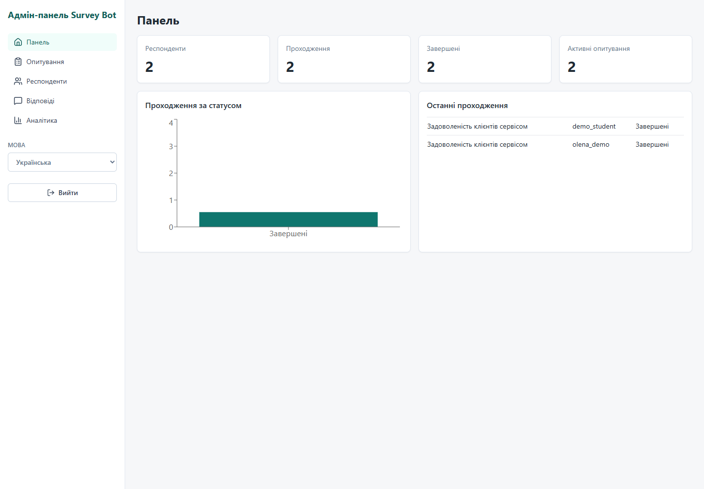
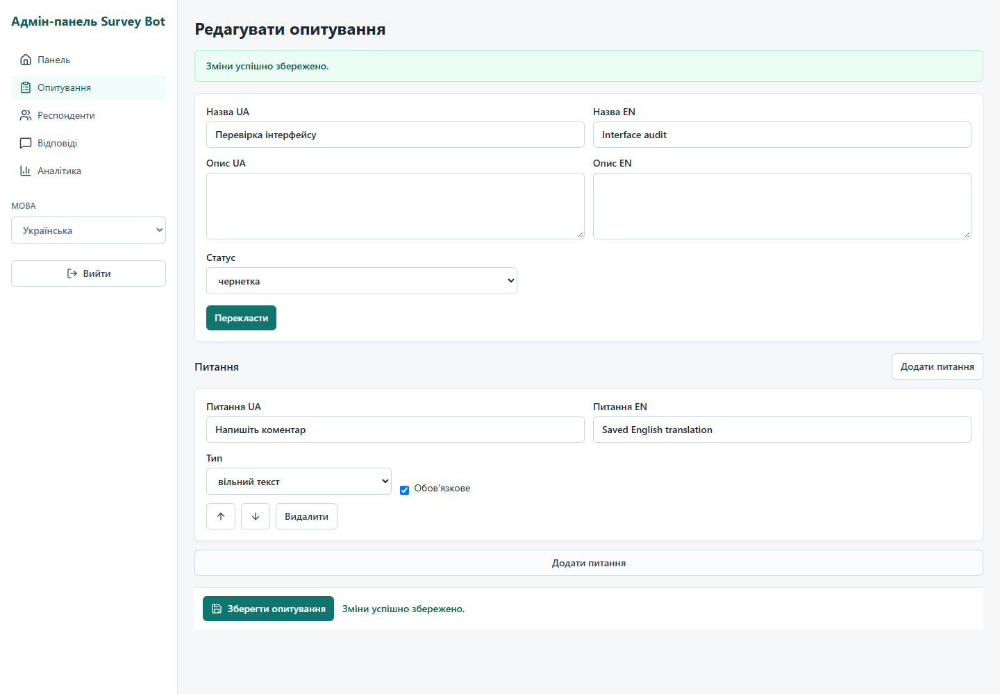
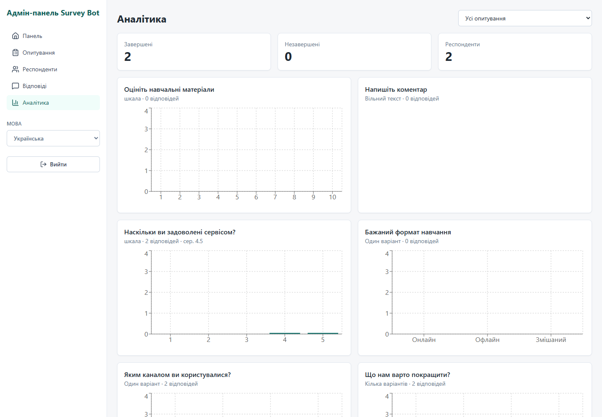

# РОЗДІЛ 3 ПРОГРАМНЕ ТА ТЕХНІЧНЕ ЗАБЕЗПЕЧЕННЯ

## 3.1 Засоби розробки

### 3.1.1 Серверний стек

Backend реалізовано мовою Python із FastAPI. Маршрути описують HTTP-операції, а Pydantic задає типи даних і частину обмежень. SQLAlchemy використовується для ORM-моделей та запитів до PostgreSQL, Alembic - для міграцій. Така комбінація дозволяє зберігати типізований контракт між JSON-повідомленням і реляційними сутностями без прямого доступу клієнтів до БД.

FastAPI документує механізм Bearer JWT та перевірку паролів як складові захищеного API [@fastapi]. У Survey Bot пароль зберігається у вигляді bcrypt-хешу, а JWT містить sub і exp. Стандарт JWT визначає формат тверджень, але сам токен не шифрує дані й не замінює HTTPS [@jwt]. Тому секрети та персональні дані не слід включати у відкритий payload токена.

Фактичні залежності backend зафіксовано в requirements.txt. Зокрема, використано FastAPI 0.115.6, SQLAlchemy 2.0.36, Alembic 1.14.0, Pydantic 2.10.4 та openpyxl 3.1.5. Наявність версії у файлі не означає відсутності відомих вразливостей; для публічного сервісу потрібні регулярний dependency audit та контрольована процедура оновлення. Під час цієї перевірки не заявляється повний зовнішній penetration test.

### 3.1.2 Telegram-клієнт

Для бота застосовано aiogram 3.16.0. FSM визначає стан answering та дані активного проходження: session_id, survey, index, selected і lang. Документація aiogram описує FSM як спосіб маршрутизації багатокрокового діалогу [@aiogram]. У реалізації стан використовується для вибору обробника тексту, одинарного вибору, множинного вибору або шкали.

Бот звертається до сервера через aiohttp, а не через SQLAlchemy. Це зберігає центральну роль API та не дублює правила запису в окремому процесі. Для запиту задано тайм-аут; помилка HTTP не повинна трактуватися як успішне збереження. Поліпшення користувацького повідомлення про мережевий збій і відновлення активного сценарію залишаються важливими напрямами подальшої роботи.

Команди /start, /help, /status і /cancel мають різні призначення. /start починає вибір мови та анкети, але за наявності активної сесії не очищує її. /help показує інструкцію лише на запит. /status повідомляє поточну позицію. /cancel спочатку передає скасування серверу й лише після успіху очищує локальний стан. Останній порядок важливий: інакше бот забуде сесію, яка на сервері залишиться активною.

### 3.1.3 Вебпанель і засоби збирання

React використано для сторінок адміністратора й керування станом форм. Компонентна модель дозволяє розділити каркас, індикатори статусу та предметні сторінки [@react]. TypeScript описує типи Survey, Question, Option, AnswerRow і AnalyticsOverview. Axios додає Bearer-токен та обробляє відмову авторизації; React Router визначає переходи між сторінками.

Vite забезпечує сервер розробки й production-збірку [@vite]. Під час аудиту повторний build із latest підтягнув TypeScript 7.0.2, для якого старий moduleResolution Node перестав підтримуватися. Помилку TS5108 відтворено під час реального npm run build. Конфігурацію змінено на Bundler, що відповідає рекомендованому способу розв'язання модулів у збирачах [@ts], а версії пакетів зафіксовано за перевіреним набором.

Для оформлення застосовано Tailwind CSS 3.4.17, для іконок - lucide-react, для діаграм - Recharts. Вони розв'язують задачі представлення, але не обчислюють доменні агрегати замість сервера. Фронтенд отримує кількості та середні через API, локалізує підписи й передає масиви до графічних компонентів. Це дозволяє окремо тестувати правильність чисел і правильність візуалізації.

## 3.2 Вимоги до технічного та програмного забезпечення

### 3.2.1 Локальне середовище

Локальне розгортання складається з чотирьох сервісів Docker Compose: PostgreSQL, backend, bot і frontend. Хостом перевірки є Windows із Docker Desktop у режимі Linux-контейнерів. Backend і бот використовують Python 3.12, фронтенд збирається на Node 22. Для відтворення потрібні Docker Engine із Compose, браузер та доступ до мережі для початкового завантаження образів і пакетів.

Числові мінімальні характеристики RAM та CPU не встановлено експериментально, тому вони не подаються як доведена нижня межа. Практично слід орієнтуватися на вимоги Docker Desktop і доступний ресурс для PostgreSQL та збирання frontend. Для захисту важливо заздалегідь зібрати образи, перевірити health і не покладатися на швидкість мережі аудиторії.

Таблиця 3.1 - Компоненти середовища

| Компонент | Версія або режим | Призначення |
|---|---|---|
| Docker Compose | Команда docker compose | Оркестрація локальних сервісів |
| PostgreSQL | Образ postgres:16-alpine | Реляційне зберігання |
| Python | Образ python:3.12-slim | API та бот |
| Node.js | Образ node:22-alpine | Фронтенд |
| Веббраузер | Сучасний Chromium-сумісний або інший актуальний | Адмін-панель |
| Telegram | Обліковий запис і bot token | Реальний канал респондента |

### 3.2.2 Конфігурація й запуск

Файл .env створюється на основі .env.example. У ньому задаються SECRET_KEY, TELEGRAM_BOT_TOKEN, CORS та інші параметри середовища. Реальні секрети не включають до Git. Після запуску Compose backend застосовує міграції, виконує ідемпотентний seed і запускає Uvicorn. Якщо БД уже містить анкети, seed не повинен перезаписувати редаговані мовні версії.

Docker розрізняє запуск контейнера й готовність сервісу приймати запити [@docker]. Для БД використано pg_isready, для backend - HTTP healthcheck. Бот залежить від здорового backend. Сам endpoint /health наразі перевіряє живість процесу, а не виконує SQL-запит при кожному зверненні; готовність БД до початкового запуску додатково випливає з успішних міграцій. Після подальшого падіння БД цей health не є повною перевіркою її доступності.

Backend і frontend оприлюднено на loopback-адресі хоста. PostgreSQL доступна всередині Docker-мережі без зовнішнього порту. Під час аудиту спроба прив'язати 5432 до хоста завершилася помилкою доступу до сокета; зовнішнє оприлюднення БД вилучено як непотрібне для контейнерного сценарію. Це не вимагало видалення тому з реальними даними.

```powershell
Copy-Item .env.example .env
# Внести власні секрети у .env до запуску.
docker compose up -d --build
docker compose ps
docker compose logs --tail 50 backend bot
```

Нормальний порядок запуску: здорова PostgreSQL, міграції та seed, API, Telegram polling і вебсервер. Для зупинки використовується docker compose down без параметра -v. Видалення тому через down -v не є звичайною зупинкою: воно знищує збережені дані й не використовується у цьому дослідженні.

### 3.2.3 Відокремлення тестового середовища

Щоб не змінювати реальні відповіді, створено окрему БД survey_audit_20261115 в тому самому PostgreSQL-сервері. Вона має власні таблиці та міграції. Для HTTP-перевірок піднято окремий API на localhost:8001, а для браузерних - окремий frontend на localhost:5174. Така ізоляція не є повною ізоляцією ресурсів хоста, але забезпечує розділення наборів даних.

Тестові скрипти додатково перевіряють префікс назви БД перед виконанням змін. Це захищає від випадкового запуску очищення тестових об'єктів у основній базі. Видаляються лише об'єкти, створені тестами. Тести не виконують DROP для реальних таблиць, не видаляють Docker volume та не переписують історичні відповіді.

## 3.3 Опис програмної реалізації

### 3.3.1 Структура сервера та REST API

Точка входу app.main створює FastAPI, додає CORS middleware й підключає api_router з префіксом /api/v1. Каталог models містить ORM-класи, schemas - Pydantic DTO, services - операції з анкетами, аудитом і статистикою, api/v1/endpoints - HTTP-маршрути. Окремого повного repository layer немає; його не слід приписувати архітектурі лише через початкові побажання до структури.

Адміністративні маршрути перевіряють get_current_admin. Функція декодує JWT з дозволеним алгоритмом, перевіряє sub і завантажує активного адміністратора. Під час аудиту додано перевірку числового формату sub, щоб некоректне значення не спричиняло неперехоплений ValueError. Вхід неактивного адміністратора також відхиляється.

OAuth2PasswordBearer використано як механізм отримання Bearer-заголовка, але login приймає JSON із email і password. Тому повну сумісність форми OAuth2 Password Flow у Swagger UI не слід вважати автоматично гарантованою. Для програмних клієнтів контракт login є JSON; адмін-панель використовує саме його.

Таблиця 3.2 - Групи маршрутів

| Група | Приклади операцій | Доступ |
|---|---|---|
| auth | login, me | Вхід або JWT |
| surveys | CRUD анкет, CRUD питань | JWT адміністратора |
| respondents | Перелік респондентів | JWT адміністратора |
| responses | Сесії та відповіді | JWT адміністратора |
| analytics | overview із фільтрами | JWT адміністратора |
| export | CSV та XLSX анкети | JWT адміністратора |
| translate | Переклад тексту | JWT адміністратора |
| public | Анкети, респонденти, сесії, відповіді | Службовий X-Bot-Key |

### 3.3.2 Збереження питань і варіантів

Раніше клієнт надсилав ID варіанта, але QuestionUpdate використовував список OptionCreate без поля id. Pydantic відкидав зайве поле, після чого сервіс не знаходив відповідності старому варіанту й створював новий. Відповідь могла втратити option_id через ON DELETE SET NULL, а JSONB-список множинного вибору містив застарілі ID. Видимим симптомом була порожня діаграма при ненульовій кількості відповідей.

Виправлення полягає в окремій схемі OptionUpdate з необов'язковим id та збереженні ID у React-редакторі. Сервіс оновлює відповідний запис, якщо ID належить поточному питанню, і створює новий лише для нового варіанта. Регресійний тест спочатку записує відповідь, потім змінює переклади й перевіряє незмінність зовнішнього ключа. Це тестує причину дефекту, а не лише появу стовпчика.

Редактор також отримав оновлення локальних даних після успішного збереження. Новим питанням призначаються серверні ID, тому повторне натискання не повинно знову створювати ті самі питання. Видалені з форми початкові питання передаються як DELETE-запити. Операція збереження всієї анкети залишається послідовністю HTTP-запитів, а не єдиною атомарною транзакцією; часткова відмова потребує повідомлення користувача й подальшого вдосконалення API.

### 3.3.3 Перевірка відповідей та завершення

Сервер перевіряє існування активної сесії та належність питання її анкеті. Для одинарного вибору допустимий один із ID варіантів питання; для множинного - непорожній список лише його варіантів. Для тексту відхиляються порожні та суто пробільні значення. Для шкали перевіряються мінімум і максимум з явною обробкою None, що зберігає допустимий нуль.

Перед записом сервер залишає лише поле, яке відповідає типу питання. Це запобігає ситуації, коли разом із option_id передано text_value і експортер помилково віддав перевагу сторонньому тексту. Дубльовані ID множинного вибору усуваються. Після завершення сесії нові відповіді відхиляються.

До виправлення complete_session безумовно встановлював completed. Тепер він порівнює множину обов'язкових питань із множиною відповідей. За відсутніх питань повертається 422. Для cancelled повертається 409. Це серверна перевірка, тому обхід інтерфейсу не дозволяє завершити порожню сесію за допомогою прямого HTTP-запиту.

### 3.3.4 FSM та захист діалогового сценарію

На початку активного проходження FSM містить ID сесії й повну структуру анкети. Обробники /start і вибору іншої анкети перевіряють наявність session_id та повідомляють про необхідність завершити або скасувати поточний сценарій. Зміна мови через стару кнопку також не повинна відкривати новий список анкет посеред проходження. Інструкція не надсилається автоматично після /start або вибору мови.

Після успішної відповіді inline-клавіатура попереднього повідомлення прибирається, а ізоляція подій обмежує одночасну обробку повідомлень одного діалогу. Проте ці заходи не замінюють повного серверного контролю активної сесії. Після перезапуску бота пам'ять FSM втрачається, а службовий API наразі не встановлює глобальної заборони на дві активні сесії одного респондента. Це явно зафіксоване обмеження, а не реалізована гарантія.

Старі callback-повідомлення також потребують зв'язування з конкретною сесією та питанням. У поточному форматі одинарний вибір містить ID варіанта, але шкала передає лише число. Валідація API відхилить чужий варіант, однак старе числове натискання може відповідати допустимому значенню наступного шкального питання. Для наступної версії рекомендовано включити session_id і question_id у callback_data та перевіряти їх перед переходом.

### 3.3.5 Мультимовність та автоматичний переклад

Контекст i18n зберігає en або uk у localStorage та надає функцію t. Після зміни мови змінюються навігація, статуси, заголовки й підписи. Сервер повертає обидва мовні представлення в DTO аналітики та відповідей; тому для перемикання підписів не потрібно переписувати відповіді в БД.

Автоматичний переклад виконується через deep-translator. Одна кнопка проходить назву, опис, питання й варіанти та доповнює порожню сторону мовної пари. Відповідь перекладача потрапляє у форму й потребує збереження. У разі відмови сервер повертає 503, а форма зберігає введені користувачем дані. Під час фактичного HTTP-аудиту сервіс повернув саме 503, тому якість успішного автоматичного перекладу цим запуском не підтверджена.

Наявність іншомовного первинного коментаря у локалізованій таблиці не є помилкою локалізації інтерфейсу. Важливо відрізняти текст питання, який належить анкеті, від тексту відповіді, який належить респонденту. У першому випадку обирається мовна версія, у другому зберігається оригінал. Автоматична зміна оригіналу спотворила б дослідницький матеріал.

### 3.3.6 Модель загроз і контроль безпеки

Межа довіри між браузером і сервером проходить через HTTP API. Введений у форму тип або ID не можна вважати довіреним лише тому, що звичайний інтерфейс генерує його правильно. Зловмисний або помилковий клієнт може сформувати запит без React. Тому сервер перевіряє належність питання, допустимість варіанта та стан сесії самостійно. Клієнтська валідація корисна для зручності, але не є захисним механізмом замість серверної.

Друга межа проходить між ботом і backend. Назва маршруту public не повинна означати право будь-кого записувати відповіді за довільним respondent_id. Доданий службовий ключ зменшує цей ризик для локальної архітектури. Водночас він автентифікує весь сервіс, а не окремого користувача. Якщо ключ потрапить до стороннього клієнта, потрібні ротація токена й аналіз записаних операцій.

Третя межа пов'язана з експортом. Безпечний JSON-рядок у вебтаблиці може стати активною формулою після відкриття CSV. Отже, загроза виникає не під час введення, а під час зміни середовища інтерпретації. Саме тому екранування виконується в експортері, а первинний текст у БД не змінюється. Це зберігає дослідницький оригінал і водночас обмежує небезпечну поведінку похідного файлу.

JWT зберігається у localStorage для простоти демонстрації. Такий токен доступний JavaScript-коду сторінки, тому XSS може призвести до його викрадення. У поточному інтерфейсі React відображає значення як текст, однак це не є повним аудитом усіх можливих XSS-векторів. Для публічної версії слід порівняти варіанти HttpOnly cookie з CSRF-захистом і короткоживучих access tokens, а не механічно вважати один спосіб універсальним.

Таблиця 3.4 - Межі довіри та залишкові ризики

| Межа | Реалізований контроль | Залишковий ризик |
|---|---|---|
| Браузер - API | Bearer JWT, Pydantic | localStorage, немає повного rate limiting |
| Бот - API | X-Bot-Key, тайм-аут | Один спільний секрет для службових операцій |
| API - БД | ORM і зовнішні ключі | JSONB-списки без поелементного FK |
| Відповідь - експорт | Екранування формульних префіксів | Повторне збереження CSV іншою програмою |
| API - перекладач | Лише адміністративний виклик | Передавання тексту анкети третій стороні |
| Docker - хост | Loopback і внутрішня БД | Демооблікові дані, залежність від хоста |

Принцип мінімізації даних варто застосовувати до наступної версії: для більшості технічних сценаріїв достатньо Telegram ID та обраної мови, тоді як ім'я й прізвище можуть бути необов'язковими. Період зберігання також має визначатися метою опитування. Поточна схема дозволяє накопичувати записи без автоматичного строку видалення, тому це потребує організаційного правила, а не лише нового SQL-поля.

### 3.3.7 Аналітика та експорт

build_analytics підраховує сесії за статусами, завершені проходження, унікальних учасників відібраних сесій і статистику кожного питання. Для шкал обчислюється середнє, для варіантів - частоти, для тексту повертається обмежений перелік висловлювань. Під час аудиту виправлено загальний підрахунок респондентів, який раніше не враховував фільтр анкети.

Наявна реалізація робить окремий запит відповідей для кожного питання. Для невеликого демонстраційного набору це прийнятно, але кількість SQL-запитів зростає разом із кількістю питань. Проведений короткий тест не доводить ефективності для тисяч анкет. Подальша оптимізація має спиратися на профілювання, агрегування в SQL та визначений профіль навантаження.

CSV формується через стандартний csv.writer, а XLSX - через openpyxl. Одним рядком є відповідь на конкретне питання; стовпці містять сесію, респондента, питання, значення та дату. Це довгий формат, придатний для відновлення послідовності й обробки різних типів питань. Широка матриця «одна сесія - один рядок» потребувала б іншої процедури перетворення.

Неперевірені тексти у CSV та XLSX можуть інтерпретуватися електронною таблицею як формули [@csv]. Експортер додає текстовий префікс до небезпечних початкових символів. Тест із значенням =1+1 перевіряє екранування в CSV та відсутність комірок типу formula в XLSX. Це захищає початковий експорт, але не гарантує поведінки всіх програм після повторного збереження й відкриття CSV.

## 3.4 Керівництво користувача та результати тестування

### 3.4.1 Робота адміністратора

Адміністратор відкриває localhost:5173, обирає мову та вводить дані демооблікового запису. Після входу панель показує кількість респондентів із сесіями, загальну кількість проходжень, завершені сесії та активні анкети. Таблиця останніх проходжень дозволяє зіставити анкети й статуси. Демообліковий запис призначений лише для локального показу.

Для створення анкети потрібно перейти до «Опитування», натиснути «Нове опитування», заповнити назву українською або англійською й додати питання. Для вибору задаються варіанти, для шкали - межі. Українська колонка розташована першою. Кнопка «Перекласти» доповнює порожню мовну сторону за доступності зовнішнього сервісу; адміністратор перевіряє формулювання та зберігає анкету.

У редакторі кнопка додавання доступна також після останнього питання. Кнопки зі стрілками змінюють порядок, а нижня панель збереження лишається доступною під час прокручування. Після запису показано явне повідомлення про успіх або помилку. Для перевірки результату доцільно оновити сторінку й переконатися, що мовні тексти й структура не змінилися.

Сторінка «Відповіді» показує тексти питань і варіантів мовою інтерфейсу, а не лише внутрішні ID. Сторінка «Аналітика» містить фільтр анкети й графіки. API підтримує часові фільтри, однак у наявному інтерфейсі окремі поля дат не реалізовані; не слід описувати їх як доступні користувачу елементи. CSV і XLSX завантажуються зі сторінки деталей анкети.





### 3.4.2 Робота респондента

Респондент відкриває @survey_oa_bot і надсилає /start. Після вибору мови бот показує активні анкети. Для одинарного вибору слід натиснути одну кнопку, для множинного - позначити потрібні варіанти й підтвердити «Готово», для шкали - число, для тексту - надіслати повідомлення. Після успішного завершення бот повідомляє про збереження відповідей.

Під час активного проходження спроба вибрати іншу анкету повинна бути заблокована локальним сценарієм. Команда /status показує позицію, /cancel скасовує поточну сесію, а /help виводить інструкцію. Повідомлення інструкції не повинно з'являтися автоматично на кожному старті. Якщо бот перезапущено, відновлення прогресу не гарантоване в поточній MemoryStorage.

### 3.4.3 Організація експериментальної перевірки

Перевірку проведено 15 листопада 2026 року на локальному середовищі. Основна БД містила чотири анкети, 15 сесій і 56 відповідей; ці значення зафіксовано лише як стан демонстраційного сховища. Для експериментів використовувалася окрема БД. Не проводилося залучення нової дослідницької вибірки людей або порівняльне вимірювання їхньої поведінки.

Перший рівень перевірки становлять сім інтеграційних unittest-тестів, які безпосередньо викликають серверні операції та працюють із реальною PostgreSQL. Вони охоплюють чотири типи відповідей, завершення, недопустимі значення, заміну повторної відповіді, збереження ID при редагуванні, захист експорту та некоректний JWT. Це не mock БД і не Telegram E2E.

Другий рівень - 25 HTTP-перевірок окремого Uvicorn API. Вони включають вхід, відмову без JWT, відмову без службового ключа, створення анкети, відповіді всіх типів, завершення, скасування, аналітику, повторне читання перекладу та розбір CSV/XLSX. Контрольний текст формули використано як безпечний тестовий рядок, без виконання зовнішніх команд чи доступу до файлів користувача.

Додатковий набір містить вісім unit-тестів обробників FSM. Вони перевіряють блокування іншої анкети, старої мовної кнопки, поведінку /start за активної сесії, явну команду /help, скасування, локалізацію та нульову межу шкали. Усі вісім успішні, але мережеві виклики тут замінено AsyncMock. Такий набір перевіряє локальну логіку обробника, а не зв'язок із Telegram-платформою.

Таблиця 3.3 - Підтверджені результати перевірки

| Перевірка | Фактичний результат | Межа висновку |
|---|---|---|
| Міграції порожньої БД | Три ревізії застосовано | Не перевіряє безпечний downgrade реальних даних |
| Інтеграційні тести | 7 із 7 успішні | Сервісний рівень із PostgreSQL |
| HTTP-перевірки | 25 із 25 успішні | API та БД, не Telegram-клієнт |
| Production build | Успішний після виправлення TS | Залишилося попередження про розмір JS |
| Автопереклад | HTTP 503 | Перевірено відмову, не якість перекладу |
| Polling бота | Процес почав отримання оновлень | Не підтверджує повне проходження людиною |
| Браузерний вхід і UA | Підтверджено окремою перевіркою | Не замінює повний UI-регресійний набір |

Автоматизований UI-набір додатково перевірив шість представлень, перемикання мови, створення анкети й повторне збереження. Після reload англійське питання мало контрольний текст Saved English translation. Для viewport 390 × 844 горизонтальне переповнення не виявлено, браузерних pageerror не зафіксовано. Це точні результати виконаного сценарію; вони не охоплюють усіх можливих комбінацій довгих текстів та браузерів.



### 3.4.4 Проєктування тестових класів

Для кожного типу питання визначено класи еквівалентності. Одинарний вибір має допустимий ID, чужий ID та відсутнє значення. Множинний вибір має непорожній допустимий список, порожній список, сторонній елемент і дубль. Текст має змістовний рядок, порожній рядок і пробіли. Шкала має внутрішнє значення, обидві межі й значення поза ними. Частина цих класів автоматизована у поточному наборі, решта становить план розширення регресії.

Граничні значення важливіші за випадкове збільшення числа подібних тестів. Нульова нижня межа виявляє дефект використання or, якого не видно на звичайній шкалі 1-5. Збереження вже вибраного варіанта виявляє втрату ключа, якої не видно на порожній анкеті. Повторне читання після збереження виявляє проблему серіалізації, якої не видно відразу після зміни React state.

Таблиця 3.5 - Класи перевірок і статус покриття

| Клас | Контроль | Стан |
|---|---|---|
| Одинарний допустимий вибір | Запис і частота 1 | Виконано |
| Чужий ID | Відхилення 422 | Виконано на сервісному рівні |
| Множинний допустимий список | Дві частоти для однієї відповіді | Виконано |
| Дубль у множинному списку | Усунення повтору | Реалізовано; окремий тест розширити |
| Порожній текст | Відхилення | Виконано для пробільного рядка |
| Нуль у шкалі | Запис і середнє 0 | Виконано |
| Вище максимуму | Відхилення | Виконано |
| Нижче мінімуму | Відхилення | Реалізовано; окремий тест розширити |
| Неповне завершення | 422 | Виконано через HTTP |
| Повторний запис | Один послідовний результат | Виконано без конкуренції |
| Одночасний запис тієї самої пари | Єдиний результат у БД | Не виконано; потрібен UNIQUE |
| Збереження перекладу | Значення після reload | Виконано в браузері |
| Недоступний перекладач | 503 без хибного успіху | HTTP-відмову підтверджено |
| Restart бота | Відновлення прогресу | Не реалізовано персистентну FSM |
| Повний Telegram-діалог | Транспорт і всі клавіатури | Потребує реального E2E |

Перевірка незмінності завершеної сесії відокремлюється від перевірки прав користувача на її ID. Перша виконана: сервер відхиляє запис після completed. Друга наразі спирається на довіру до службового клієнта. Для багатоклієнтської або публічної архітектури слід прив'язати операцію до автентифікованого респондента чи підписаного контексту сесії. Одного факту 401 без ключа недостатньо для повної оцінки авторизації об'єктів.

### 3.4.5 Короткий навантажувальний дослід

У межах HTTP-аудиту виконано 80 запитів аналітики з вісьмома паралельними робочими потоками на малому ізольованому наборі. Зафіксовано нуль HTTP-помилок, тривалість 0,892 с, медіану 87,48 мс, 95-й перцентиль 102,96 мс та спостережувану пропускну здатність 89,72 запиту за секунду. Це результати конкретного короткого запуску, збережені у JSON-протоколі.

Ці значення не можна подавати як гарантовану промислову продуктивність. Дослід не містить довготривалого прогріву, різних обсягів даних, змішаного запису й читання, затримок Telegram або кількох хостів. На результат впливають спільний Docker-хост, стан кешів і планувальник операційної системи. Для визначення SLO потрібні повторні серії та контрольований профіль навантаження.

Практичний висновок обмежений: на заданому малому наборі перевірений endpoint відповів на всі 80 запитів без помилок у межах цього запуску. Підстав стверджувати підтримку певної кількості одночасних респондентів немає. Необхідно окремо виміряти запис відповідей, конкуренцію за один session_id та зростання SQL-витрат зі збільшенням кількості питань.

### 3.4.6 Виявлені дефекти та обмеження

Найбільш критичним дефектом виявився старий скрипт repair_answers, який призначав втрачені варіанти циклічно або вибирав перші елементи. Це не відновлення, оскільки джерело початкового вибору відсутнє. Скрипт прибрано з автоматичного запуску й переведено в read-only перевірку. Поточний запуск перед виправленням повідомив про нуль таких підстановок, але попередню історію змін відповідей без резервної копії підтвердити неможливо.

Виправлено також втрату option_id через схему PATCH, безумовне завершення порожньої сесії, помилку нульової межі шкали, приймання пробільного тексту, недостатню службову автентифікацію, небезпечні комірки експорту та нефіксовані frontend-залежності. Для кожного виправлення визначено регресійний сценарій або явну перевірку збирання.

Залишкові обмеження: FSM не персистентна; немає повної версійності опублікованих анкет; масив JSONB не має поелементних зовнішніх ключів; збереження всієї форми не атомарне; сторінки великих списків не мають пагінації; API не містить повноцінного rate limiting; JWT у localStorage потребує особливої уваги до XSS; немає перевіреного відновлення з backup; чутливі тексти можуть передаватися зовнішньому перекладачу.

До публічного впровадження слід визначити політику конфіденційності, додати TLS, замінити демореквізити, провести перевірку залежностей і виконати реальний Telegram E2E. Ці роботи не є декоративними покращеннями: вони змінюють рівень допустимого використання продукту. Наявна версія придатна передусім для контрольованої локальної демонстрації й подальшого розвитку.

### 3.4.7 Відновлення та передача в експлуатацію

Резервна копія має перевірятися відновленням, а не лише фактом створення файлу. Для PostgreSQL доцільний окремий контрольований процес pg_dump та відновлення в нову БД. У цьому аудиті реальний restore основної БД не виконувався, тому відновлюваність не оголошується підтвердженою. Перед демонстрацією слід мати локальну копію налаштувань без публікації секретів та окремий експорт потрібної анкети.

План передачі включає перевірку версії гілки, застосування міграцій, health, вхід адміністратора, створення тестової анкети та контрольний експорт. Після цього виконується Telegram-сценарій із чотирма типами питань. Якщо зовнішній сервіс недоступний, цей факт записується в протоколі й не підміняється демонстрацією прямого API. Успішність локальної панелі та успішність Telegram оцінюються окремо.

Для зміни опублікованої анкети рекомендовано спочатку закрити збирання, зберегти експорт і створити копію як нову версію. Це організаційний обхід відсутності версійності, а не нова реалізована функція автоматичного копіювання. Пряме видалення питань із відповідями може видалити дані каскадно, тому його не слід виконувати на реальній анкеті без розуміння наслідків.

Після запуску користувачеві потрібна зрозуміла процедура зупинки. Команда docker compose down видаляє контейнери та мережу проєкту, зберігаючи named volume. Параметр -v має інші наслідки й не входить до звичайної інструкції. Для тимчасових audit-контейнерів використовуються окремі назви, щоб їх можна було зупинити без втручання в основний проєкт.

## Висновки до розділу 3

Досліджено фактичну структуру програмного продукту та встановлено відповідність між API, моделями, ботом і вебпанеллю. Виправлено підтверджені дефекти збереження, завершення, локалізації й експорту, а також відтворено та усунуто збій frontend-збірки. Окремі інтеграційні та HTTP-перевірки виконано на реальній PostgreSQL без зміни основного набору відповідей.

Результати короткого навантажувального запуску наведено з точними умовами та обмеженнями. Недоступність зовнішнього перекладача й відсутність повного реального Telegram-проходження не приховано. Сформовано перелік необхідних робіт для переходу від навчальної локальної демонстрації до публічного сервісу.
