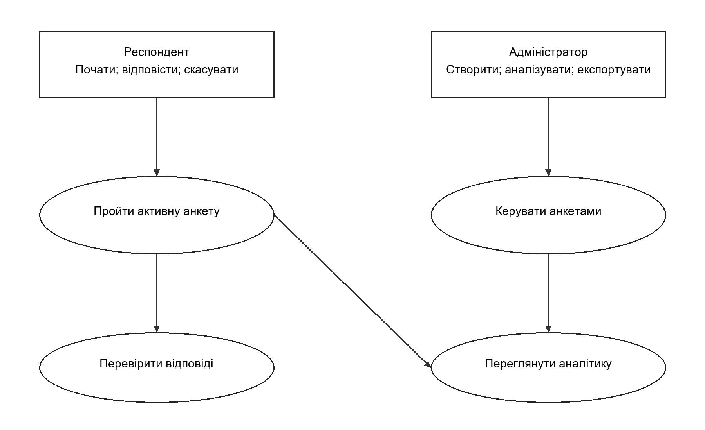
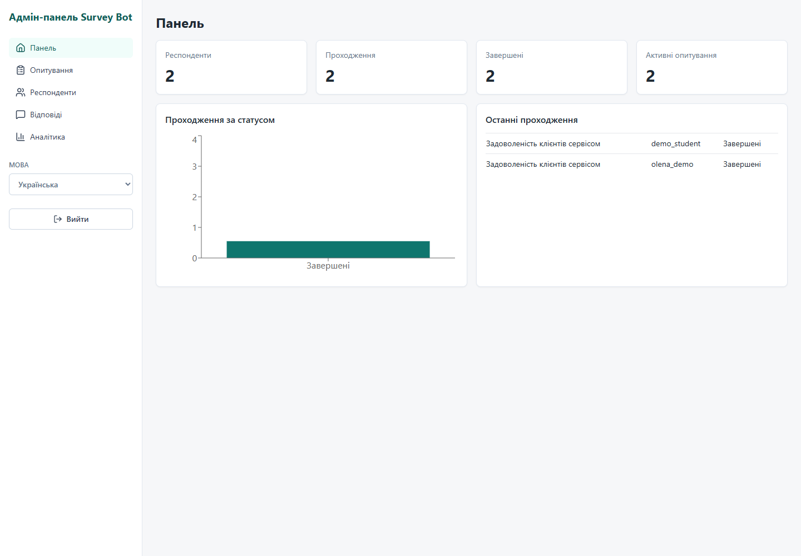
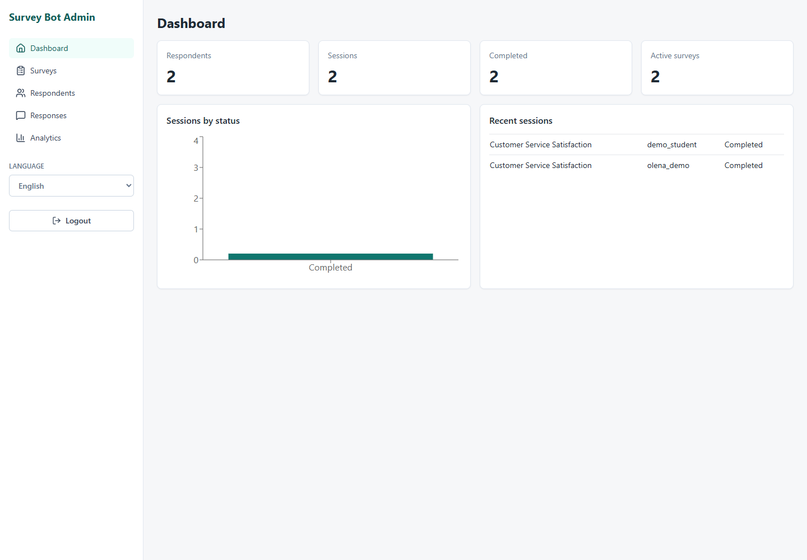
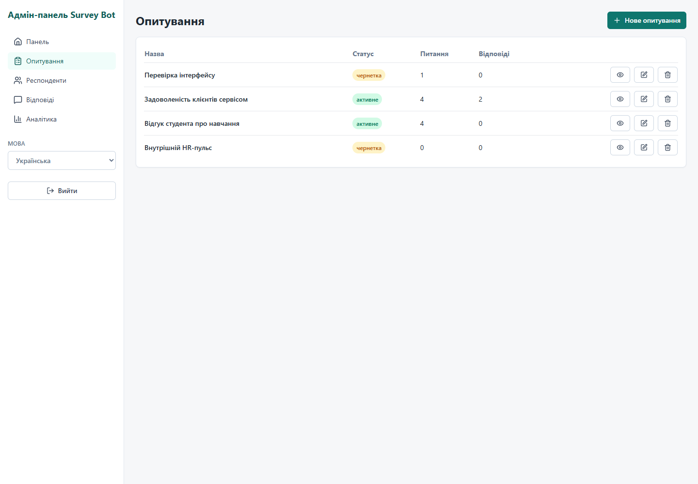
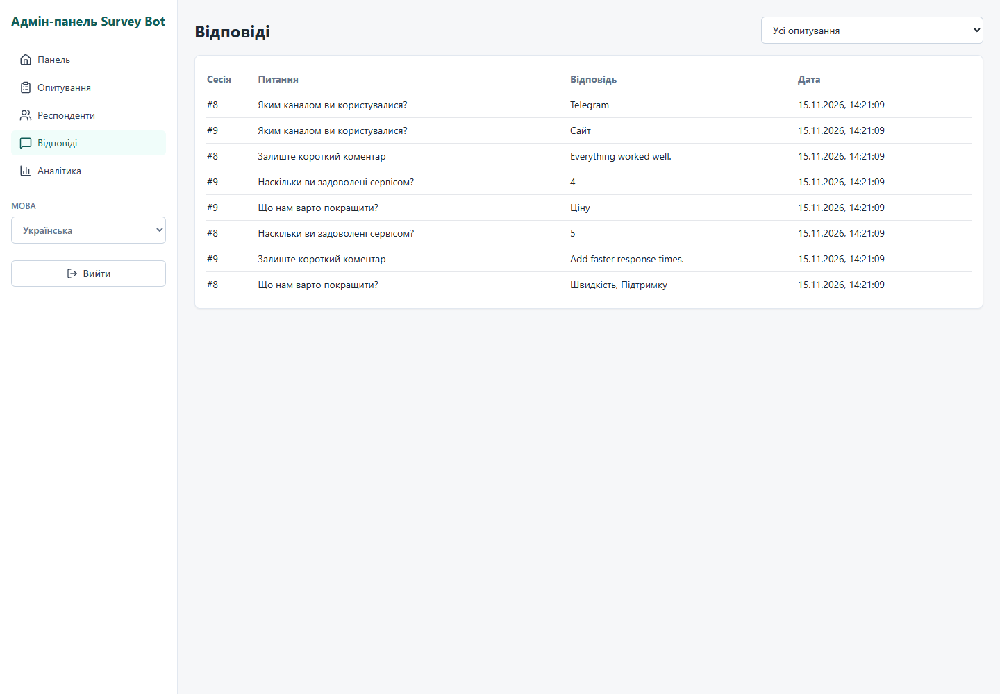
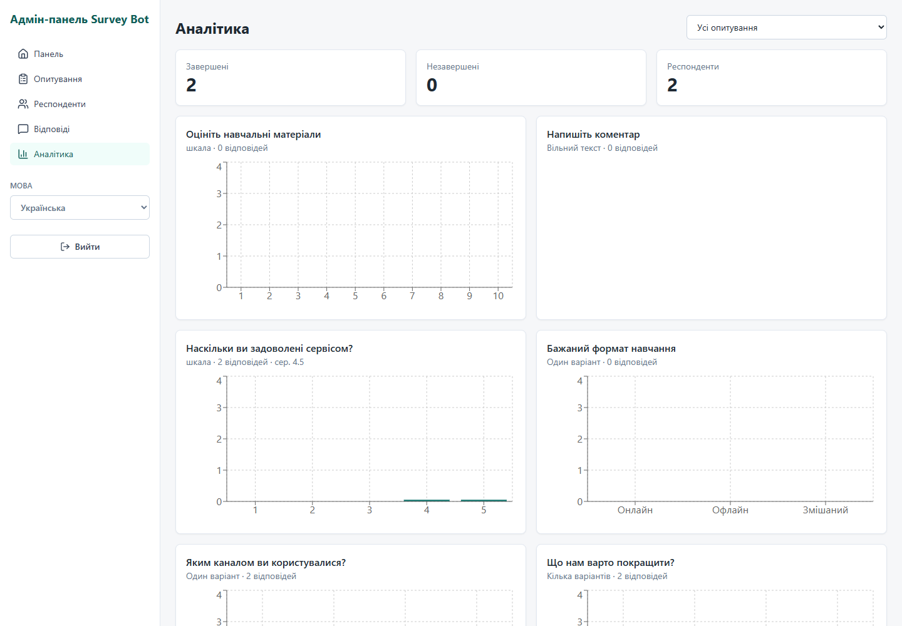
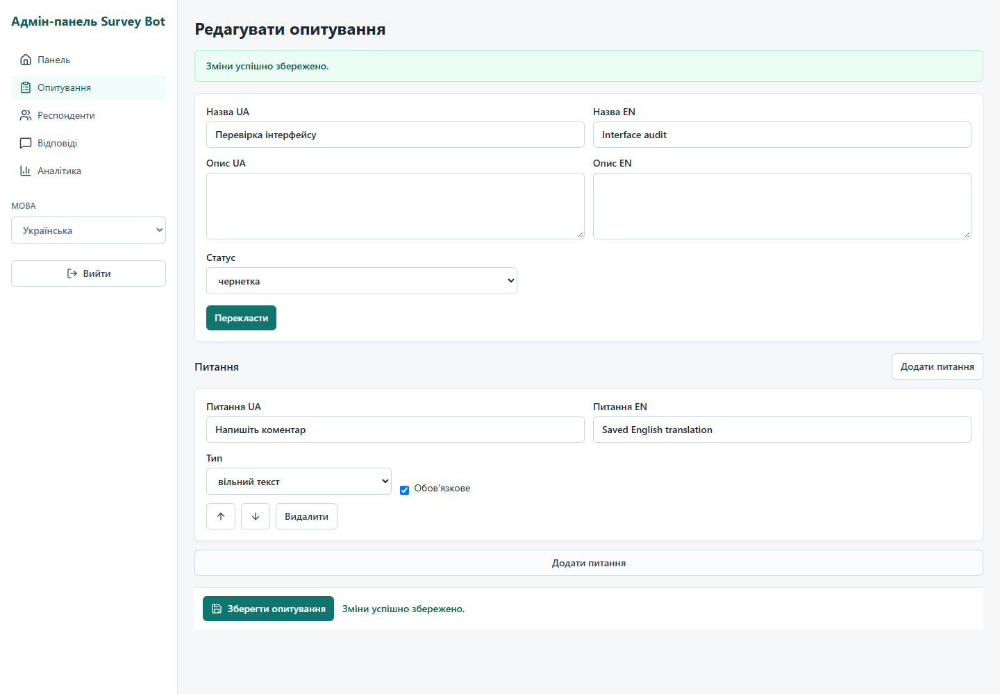
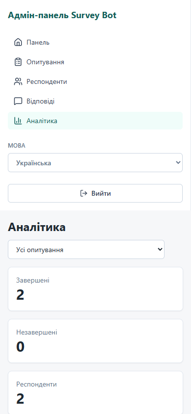

# ДОДАТОК А ФУНКЦІОНАЛЬНІ ТА ІНФОРМАЦІЙНІ МОДЕЛІ

Діаграми узгоджено з поточною структурою коду. Вони не описують неіснуючі мікросервіси або автоматичне масштабування.



# ДОДАТОК Б СЛОВНИК ДАНИХ

## Б.1 Таблиця admins

Облікові записи адміністраторів. Пароль зберігається лише як хеш; email має унікальний індекс.

Джерело визначення: backend/app/models/admin.py. Наведені обмеження відтворюють ORM-модель; додаткові правила API описано в основному тексті.

| Поле | Визначення та обмеження |

|---|---|

| id | Integer, primary_key=True |

| email | String(255), unique=True, index=True, nullable=False |

| full_name | String(255), nullable=False |

| hashed_password | String(255), nullable=False |

| is_active | Boolean, default=True, nullable=False |

| created_at | DateTime(timezone=True), server_default=func.now(), nullable=False |

## Б.2 Таблиця answers

Первинні відповіді. JSONB-список множинного вибору перевіряє прикладний код.

Джерело визначення: backend/app/models/answer.py. Наведені обмеження відтворюють ORM-модель; додаткові правила API описано в основному тексті.

| Поле | Визначення та обмеження |

|---|---|

| id | Integer, primary_key=True |

| session_id | ForeignKey('survey_sessions.id', ondelete='CASCADE'), index=True, nullable=False |

| question_id | ForeignKey('questions.id', ondelete='CASCADE'), index=True, nullable=False |

| option_id | ForeignKey('question_options.id', ondelete='SET NULL'), nullable=True |

| text_value | Text, nullable=True |

| number_value | Integer, nullable=True |

| option_ids | JSONB, nullable=True |

| created_at | DateTime(timezone=True), server_default=func.now(), nullable=False |

## Б.3 Таблиця audit_logs

Записи адміністративних дій. Журнал не є повним event sourcing і не дозволяє автоматично відновлювати всі первинні значення.

Джерело визначення: backend/app/models/audit_log.py. Наведені обмеження відтворюють ORM-модель; додаткові правила API описано в основному тексті.

| Поле | Визначення та обмеження |

|---|---|

| id | Integer, primary_key=True |

| admin_id | ForeignKey('admins.id', ondelete='SET NULL'), index=True, nullable=True |

| action | String(255), nullable=False |

| entity_type | String(100), nullable=False |

| entity_id | Integer, nullable=True |

| details | JSONB, nullable=True |

| created_at | DateTime(timezone=True), server_default=func.now(), nullable=False |

## Б.4 Таблиця questions

Питання анкети. position визначає порядок; тип керує допустимим полем відповіді.

Джерело визначення: backend/app/models/question.py. Наведені обмеження відтворюють ORM-модель; додаткові правила API описано в основному тексті.

| Поле | Визначення та обмеження |

|---|---|

| id | Integer, primary_key=True |

| survey_id | ForeignKey('surveys.id', ondelete='CASCADE'), index=True, nullable=False |

| text | Text, nullable=False |

| text_en | Text, nullable=True |

| text_uk | Text, nullable=True |

| type | String(32), nullable=False |

| is_required | Boolean, default=True, nullable=False |

| position | Integer, default=0, nullable=False |

| scale_min | Integer, nullable=True |

| scale_max | Integer, nullable=True |

| created_at | DateTime(timezone=True), server_default=func.now(), nullable=False |

## Б.5 Таблиця question_options

Варіант відповіді зі стабільним ключем. Редагування тексту не повинно замінювати ID.

Джерело визначення: backend/app/models/question_option.py. Наведені обмеження відтворюють ORM-модель; додаткові правила API описано в основному тексті.

| Поле | Визначення та обмеження |

|---|---|

| id | Integer, primary_key=True |

| question_id | ForeignKey('questions.id', ondelete='CASCADE'), index=True, nullable=False |

| text | String(500), nullable=False |

| text_en | String(500), nullable=True |

| text_uk | String(500), nullable=True |

| position | Integer, default=0, nullable=False |

## Б.6 Таблиця telegram_users

Профіль респондента. Telegram ID є ідентифікатором платформи, а не доказом анонімності.

Джерело визначення: backend/app/models/respondent.py. Наведені обмеження відтворюють ORM-модель; додаткові правила API описано в основному тексті.

| Поле | Визначення та обмеження |

|---|---|

| id | Integer, primary_key=True |

| telegram_id | BigInteger, unique=True, index=True, nullable=False |

| username | String(255), nullable=True |

| first_name | String(255), nullable=True |

| last_name | String(255), nullable=True |

| language_code | String(16), nullable=True |

| created_at | DateTime(timezone=True), server_default=func.now(), nullable=False |

| updated_at | DateTime(timezone=True), server_default=func.now(), onupdate=func.now(), nullable=False |

## Б.7 Таблиця surveys

Структурна одиниця анкети. Мовні поля є представленнями тієї самої сутності.

Джерело визначення: backend/app/models/survey.py. Наведені обмеження відтворюють ORM-модель; додаткові правила API описано в основному тексті.

| Поле | Визначення та обмеження |

|---|---|

| id | Integer, primary_key=True |

| title | String(255), nullable=False |

| title_en | String(255), nullable=True |

| title_uk | String(255), nullable=True |

| description | Text, nullable=True |

| description_en | Text, nullable=True |

| description_uk | Text, nullable=True |

| status | String(32), default='draft', index=True, nullable=False |

| created_by_id | ForeignKey('admins.id', ondelete='SET NULL'), nullable=True |

| created_at | DateTime(timezone=True), server_default=func.now(), nullable=False |

| updated_at | DateTime(timezone=True), server_default=func.now(), onupdate=func.now(), nullable=False |

## Б.8 Таблиця survey_sessions

Сесія проходження конкретним респондентом. started_at є основою часового відбору.

Джерело визначення: backend/app/models/survey_session.py. Наведені обмеження відтворюють ORM-модель; додаткові правила API описано в основному тексті.

| Поле | Визначення та обмеження |

|---|---|

| id | Integer, primary_key=True |

| survey_id | ForeignKey('surveys.id', ondelete='CASCADE'), index=True, nullable=False |

| respondent_id | ForeignKey('telegram_users.id', ondelete='CASCADE'), index=True, nullable=False |

| status | String(32), default='in_progress', index=True, nullable=False |

| started_at | DateTime(timezone=True), server_default=func.now(), nullable=False |

| completed_at | DateTime(timezone=True), nullable=True |

# ДОДАТОК В КОНТРАКТИ REST API

Наведено інвентар маршрутів, отриманий зі схеми OpenAPI фактично запущеного сервера. Службові маршрути потребують X-Bot-Key, адміністративні - Bearer JWT. Наявність контракту не означає окремий E2E-тест кожної операції.

## GET /health

Health

| Властивість | Контракт |

|---|---|

| Операція | health_health_get |

| Відповіді | 200 |

## POST /api/v1/auth/login

Login

| Властивість | Контракт |

|---|---|

| Операція | login_api_v1_auth_login_post |

| Відповіді | 200, 422 |

Тіло запиту відповідає схемі LoginRequest.

| Поле запиту | Обов’язковість і тип |

|---|---|

| email | Так; string |

| password | Так; string |

## GET /api/v1/auth/me

Me

| Властивість | Контракт |

|---|---|

| Операція | me_api_v1_auth_me_get |

| Відповіді | 200 |

## GET /api/v1/surveys

List Surveys

| Властивість | Контракт |

|---|---|

| Операція | list_surveys_api_v1_surveys_get |

| Відповіді | 200 |

## POST /api/v1/surveys

Create

| Властивість | Контракт |

|---|---|

| Операція | create_api_v1_surveys_post |

| Відповіді | 201, 422 |

Тіло запиту відповідає схемі SurveyCreate.

| Поле запиту | Обов’язковість і тип |

|---|---|

| title | Так; string |

| title_en | Ні; nullable / складений тип |

| title_uk | Ні; nullable / складений тип |

| description | Ні; nullable / складений тип |

| description_en | Ні; nullable / складений тип |

| description_uk | Ні; nullable / складений тип |

| status | Ні; SurveyStatus |

| questions | Ні; array |

## GET /api/v1/surveys/{survey_id}

Detail

| Властивість | Контракт |

|---|---|

| Операція | detail_api_v1_surveys__survey_id__get |

| Відповіді | 200, 422 |

| survey_id | path; обов’язковий; integer |

## PATCH /api/v1/surveys/{survey_id}

Update

| Властивість | Контракт |

|---|---|

| Операція | update_api_v1_surveys__survey_id__patch |

| Відповіді | 200, 422 |

| survey_id | path; обов’язковий; integer |

Тіло запиту відповідає схемі SurveyUpdate.

| Поле запиту | Обов’язковість і тип |

|---|---|

| title | Ні; nullable / складений тип |

| title_en | Ні; nullable / складений тип |

| title_uk | Ні; nullable / складений тип |

| description | Ні; nullable / складений тип |

| description_en | Ні; nullable / складений тип |

| description_uk | Ні; nullable / складений тип |

| status | Ні; nullable / складений тип |

## DELETE /api/v1/surveys/{survey_id}

Delete

| Властивість | Контракт |

|---|---|

| Операція | delete_api_v1_surveys__survey_id__delete |

| Відповіді | 204, 422 |

| survey_id | path; обов’язковий; integer |

## POST /api/v1/surveys/{survey_id}/questions

Add Question

| Властивість | Контракт |

|---|---|

| Операція | add_question_api_v1_surveys__survey_id__questions_post |

| Відповіді | 201, 422 |

| survey_id | path; обов’язковий; integer |

Тіло запиту відповідає схемі QuestionCreate.

| Поле запиту | Обов’язковість і тип |

|---|---|

| text | Так; string |

| text_en | Ні; nullable / складений тип |

| text_uk | Ні; nullable / складений тип |

| type | Так; QuestionType |

| is_required | Ні; boolean |

| position | Ні; integer |

| scale_min | Ні; nullable / складений тип |

| scale_max | Ні; nullable / складений тип |

| options | Ні; array |

## PATCH /api/v1/surveys/{survey_id}/questions/{question_id}

Edit Question

| Властивість | Контракт |

|---|---|

| Операція | edit_question_api_v1_surveys__survey_id__questions__question_id__patch |

| Відповіді | 200, 422 |

| survey_id | path; обов’язковий; integer |

| question_id | path; обов’язковий; integer |

Тіло запиту відповідає схемі QuestionUpdate.

| Поле запиту | Обов’язковість і тип |

|---|---|

| text | Ні; nullable / складений тип |

| text_en | Ні; nullable / складений тип |

| text_uk | Ні; nullable / складений тип |

| type | Ні; nullable / складений тип |

| is_required | Ні; nullable / складений тип |

| position | Ні; nullable / складений тип |

| scale_min | Ні; nullable / складений тип |

| scale_max | Ні; nullable / складений тип |

| options | Ні; nullable / складений тип |

## DELETE /api/v1/surveys/{survey_id}/questions/{question_id}

Remove Question

| Властивість | Контракт |

|---|---|

| Операція | remove_question_api_v1_surveys__survey_id__questions__question_id__delete |

| Відповіді | 204, 422 |

| survey_id | path; обов’язковий; integer |

| question_id | path; обов’язковий; integer |

## GET /api/v1/respondents

List Respondents

| Властивість | Контракт |

|---|---|

| Операція | list_respondents_api_v1_respondents_get |

| Відповіді | 200 |

## GET /api/v1/responses/sessions

List Sessions

| Властивість | Контракт |

|---|---|

| Операція | list_sessions_api_v1_responses_sessions_get |

| Відповіді | 200, 422 |

| survey_id | query; необов’язковий; схема |

## GET /api/v1/responses/answers

List Answers

| Властивість | Контракт |

|---|---|

| Операція | list_answers_api_v1_responses_answers_get |

| Відповіді | 200, 422 |

| survey_id | query; необов’язковий; схема |

| session_id | query; необов’язковий; схема |

## GET /api/v1/analytics/overview

Overview

| Властивість | Контракт |

|---|---|

| Операція | overview_api_v1_analytics_overview_get |

| Відповіді | 200, 422 |

| survey_id | query; необов’язковий; схема |

| date_from | query; необов’язковий; схема |

| date_to | query; необов’язковий; схема |

## GET /api/v1/export/surveys/{survey_id}.csv

Export Csv

| Властивість | Контракт |

|---|---|

| Операція | export_csv_api_v1_export_surveys__survey_id__csv_get |

| Відповіді | 200, 422 |

| survey_id | path; обов’язковий; integer |

## GET /api/v1/export/surveys/{survey_id}.xlsx

Export Xlsx

| Властивість | Контракт |

|---|---|

| Операція | export_xlsx_api_v1_export_surveys__survey_id__xlsx_get |

| Відповіді | 200, 422 |

| survey_id | path; обов’язковий; integer |

## GET /api/v1/public/surveys

Active Surveys

| Властивість | Контракт |

|---|---|

| Операція | active_surveys_api_v1_public_surveys_get |

| Відповіді | 200, 422 |

| x-bot-key | header; необов’язковий; string |

## GET /api/v1/public/surveys/{survey_id}

Public Survey Detail

| Властивість | Контракт |

|---|---|

| Операція | public_survey_detail_api_v1_public_surveys__survey_id__get |

| Відповіді | 200, 422 |

| survey_id | path; обов’язковий; integer |

| x-bot-key | header; необов’язковий; string |

## POST /api/v1/public/respondents

Upsert Respondent

| Властивість | Контракт |

|---|---|

| Операція | upsert_respondent_api_v1_public_respondents_post |

| Відповіді | 201, 422 |

| x-bot-key | header; необов’язковий; string |

Тіло запиту відповідає схемі RespondentCreate.

| Поле запиту | Обов’язковість і тип |

|---|---|

| telegram_id | Так; integer |

| username | Ні; nullable / складений тип |

| first_name | Ні; nullable / складений тип |

| last_name | Ні; nullable / складений тип |

| language_code | Ні; nullable / складений тип |

## POST /api/v1/public/sessions

Start Session

| Властивість | Контракт |

|---|---|

| Операція | start_session_api_v1_public_sessions_post |

| Відповіді | 201, 422 |

| x-bot-key | header; необов’язковий; string |

Тіло запиту відповідає схемі SessionCreate.

| Поле запиту | Обов’язковість і тип |

|---|---|

| survey_id | Так; integer |

| respondent_id | Так; integer |

## GET /api/v1/public/sessions/{session_id}

Get Session

| Властивість | Контракт |

|---|---|

| Операція | get_session_api_v1_public_sessions__session_id__get |

| Відповіді | 200, 422 |

| session_id | path; обов’язковий; integer |

| x-bot-key | header; необов’язковий; string |

## POST /api/v1/public/sessions/{session_id}/answers

Save Answer

| Властивість | Контракт |

|---|---|

| Операція | save_answer_api_v1_public_sessions__session_id__answers_post |

| Відповіді | 201, 422 |

| session_id | path; обов’язковий; integer |

| x-bot-key | header; необов’язковий; string |

Тіло запиту відповідає схемі AnswerCreate.

| Поле запиту | Обов’язковість і тип |

|---|---|

| question_id | Так; integer |

| option_id | Ні; nullable / складений тип |

| option_ids | Ні; nullable / складений тип |

| text_value | Ні; nullable / складений тип |

| number_value | Ні; nullable / складений тип |

## POST /api/v1/public/sessions/{session_id}/complete

Complete Session

| Властивість | Контракт |

|---|---|

| Операція | complete_session_api_v1_public_sessions__session_id__complete_post |

| Відповіді | 200, 422 |

| session_id | path; обов’язковий; integer |

| x-bot-key | header; необов’язковий; string |

## POST /api/v1/public/sessions/{session_id}/cancel

Cancel Session

| Властивість | Контракт |

|---|---|

| Операція | cancel_session_api_v1_public_sessions__session_id__cancel_post |

| Відповіді | 200, 422 |

| session_id | path; обов’язковий; integer |

| x-bot-key | header; необов’язковий; string |

## POST /api/v1/translate

Translate

| Властивість | Контракт |

|---|---|

| Операція | translate_api_v1_translate_post |

| Відповіді | 200, 422 |

Тіло запиту відповідає схемі TranslationRequest.

| Поле запиту | Обов’язковість і тип |

|---|---|

| text | Так; string |

| source_lang | Так; string |

| target_lang | Так; string |

# ДОДАТОК Г ПРОТОКОЛИ ПЕРЕВІРКИ

Тести виконано в окремій PostgreSQL БД. Контрольні сутності не належать до реальних відповідей респондентів.

## Г.1 HTTP-перевірки

| Сценарій | Очікуваний результат | Фактичний результат |

|---|---|---|

| health | 200 | 200 |

| admin_without_jwt | 401 | 401 |

| bot_without_key | 401 | 401 |

| invalid_login | 401 | 401 |

| valid_login | True | True |

| incomplete_session_rejected | 422 | 422 |

| save_single_choice | 201 | 201 |

| save_multiple_choice | 201 | 201 |

| save_free_text | 201 | 201 |

| save_scale | 201 | 201 |

| complete | completed | completed |

| completed_session_is_immutable | 400 | 400 |

| preserve_option_ids | [44, 45] | [44, 45] |

| translation_persists | Edited choice | Edited choice |

| analytics_completed | 1 | 1 |

| analytics_scale_zero | 0.0 | 0.0 |

| analytics_single_count | 1 | 1 |

| analytics_multiple_count | 2 | 2 |

| csv_rows | 5 | 5 |

| csv_formula_escaped | True | True |

| xlsx_rows | 5 | 5 |

| xlsx_no_formulas | False | False |

| cancel | cancelled | cancelled |

| cancelled_complete_rejected | 409 | 409 |

| delete_test_survey | 204 | 204 |

## Г.2 Короткий навантажувальний запуск

| Показник | Виміряне значення |

|---|---|

| requests | 80 |

| workers | 8 |

| errors | 0 |

| elapsed_seconds | 0.892 |

| median_ms | 87.48 |

| p95_ms | 102.96 |

| throughput_rps | 89.72 |

| scope | HTTP analytics on a small isolated dataset, not a production capacity benchmark |

Параметри цього запуску не є SLA. Для зіставлення версій потрібні повторення на однаковому наборі даних і контроль стану хоста.

# ДОДАТОК Д ІНТЕРФЕЙС ТЕСТОВОГО СЕРЕДОВИЩА

Зображення отримано з ізольованого frontend на порту 5174 та окремої тестової БД. Демонстраційні профілі не є результатом нового опитування людей.















# ДОДАТОК Е ФРАГМЕНТИ ПРОГРАМНОЇ РЕАЛІЗАЦІЇ

Фрагменти відтворено з перевірюваної робочої копії. Вони ілюструють критичні контракти, а не замінюють повний репозиторій.

## Е.1 Перевірка адміністративного та службового доступу

Джерело: backend/app/api/deps.py

```python

import hashlib
import hmac

from fastapi import Depends, Header, HTTPException, status
from fastapi.security import OAuth2PasswordBearer
from jose import JWTError, jwt
from sqlalchemy.orm import Session

from app.core.config import settings
from app.db.session import get_db
from app.models.admin import Admin

oauth2_scheme = OAuth2PasswordBearer(tokenUrl=f"{settings.api_v1_prefix}/auth/login")


def get_bot_access(x_bot_key: str = Header(default="")) -> None:
    if not settings.telegram_bot_token or settings.telegram_bot_token.startswith("put-your"):
        raise HTTPException(status_code=503, detail="Bot access is not configured")
    expected = hashlib.sha256(settings.telegram_bot_token.encode()).hexdigest()
    if not hmac.compare_digest(x_bot_key, expected):
        raise HTTPException(status_code=401, detail="Invalid bot credentials")


def get_current_admin(db: Session = Depends(get_db), token: str = Depends(oauth2_scheme)) -> Admin:
    credentials_exception = HTTPException(
        status_code=status.HTTP_401_UNAUTHORIZED,
        detail="Could not validate credentials",
        headers={"WWW-Authenticate": "Bearer"},
    )
    try:
        payload = jwt.decode(token, settings.secret_key, algorithms=[settings.algorithm])
        admin_id = payload.get("sub")
        if not isinstance(admin_id, str) or not admin_id.isdecimal():
            raise credentials_exception
    except JWTError as exc:
        raise credentials_exception from exc
    admin = db.get(Admin, int(admin_id))
    if not admin or not admin.is_active:
        raise credentials_exception
    return admin

```

## Е.2 Збереження відповіді

Джерело: backend/app/api/v1/endpoints/public.py

```python

def save_answer(session_id: int, payload: AnswerCreate, db: Session = Depends(get_db)) -> dict[str, str]:
    session = db.get(SurveySession, session_id)
    question = db.scalar(select(Question).where(Question.id == payload.question_id).options(selectinload(Question.options)))
    if not session or session.status != "in_progress":
        raise HTTPException(status_code=400, detail="Session is not active")
    if not question or question.survey_id != session.survey_id:
        raise HTTPException(status_code=400, detail="Question does not belong to session survey")

    option_ids = [option.id for option in question.options]
    if question.type == "single_choice" and payload.option_id not in option_ids:
        raise HTTPException(status_code=422, detail="Invalid option")
    if question.type == "multiple_choice" and (not payload.option_ids or any(item not in option_ids for item in payload.option_ids)):
        raise HTTPException(status_code=422, detail="Invalid options")
    if question.type == "free_text" and not (payload.text_value or "").strip():
        raise HTTPException(status_code=422, detail="Text answer is required")
    if question.type == "scale" and (payload.number_value is None or payload.number_value < (1 if question.scale_min is None else question.scale_min) or payload.number_value > (5 if question.scale_max is None else question.scale_max)):
        raise HTTPException(status_code=422, detail="Invalid scale value")

    fields = {"single_choice": "option_id", "multiple_choice": "option_ids", "free_text": "text_value", "scale": "number_value"}
    values = {fields[question.type]: getattr(payload, fields[question.type])}
    if question.type == "multiple_choice":
        values["option_ids"] = list(dict.fromkeys(payload.option_ids))
    db.query(Answer).filter(Answer.session_id == session_id, Answer.question_id == payload.question_id).delete()
    db.add(Answer(session_id=session_id, question_id=question.id, **values))
    db.commit()
    return {"status": "saved"}

```

## Е.3 Оновлення варіантів зі збереженням ID

Джерело: backend/app/services/surveys.py

```python

def update_question(db: Session, question: Question, payload: QuestionUpdate) -> Question:
    data = payload.model_dump(exclude_unset=True)
    options = data.pop("options", None)
    for key, value in data.items():
        setattr(question, key, value)
    if options is not None:
        existing_by_id = {option.id: option for option in question.options}
        seen_ids: set[int] = set()
        for index, option in enumerate(options):
            option_id = option.get("id")
            if option_id and option_id in existing_by_id:
                item = existing_by_id[option_id]
                item.text = option["text"]
                item.text_en = option.get("text_en")
                item.text_uk = option.get("text_uk")
                item.position = option.get("position") or index
                seen_ids.add(option_id)
            else:
                db.add(QuestionOption(
                    question_id=question.id,
                    text=option["text"],
                    text_en=option.get("text_en"),
                    text_uk=option.get("text_uk"),
                    position=option.get("position") or index,
                ))
        for option_id, item in existing_by_id.items():
            if option_id not in seen_ids:
                db.delete(item)
    db.flush()
    return question

```

## Е.4 Захист експортованих комірок

Джерело: backend/app/api/v1/endpoints/export.py

```python

def safe_cell(value: str) -> str:
    # Spreadsheet applications may interpret untrusted text as formulas.
    return "'" + value if value.lstrip().startswith(("=", "+", "-", "@", "\uff1d", "\uff0b", "\uff0d", "\uff20")) or value.startswith(("\t", "\r", "\n")) else value

```

## Е.5 Регресія ідентичності після перекладу

Джерело: backend/tests/test_integrity.py

```python

    def test_translation_edit_preserves_option_identity(self):
        question = self.questions[0]
        original = question.options[0].id
        save_answer(self.session_id, AnswerCreate(question_id=question.id, option_id=original), self.db)
        payload = QuestionUpdate(text_en='Updated', text_uk='Оновлено', options=[
            {'id': item.id, 'text': item.text, 'text_en': item.text + ' EN', 'text_uk': 'Варіант'} for item in question.options])
        update_question(self.db, question, payload)
        self.db.commit()
        self.db.expire_all()
        answer = self.db.scalar(select(Answer).where(Answer.session_id == self.session_id))
        self.assertEqual(answer.option_id, original)
        self.assertEqual(self.db.get(type(question), question.id).text_en, 'Updated')

```